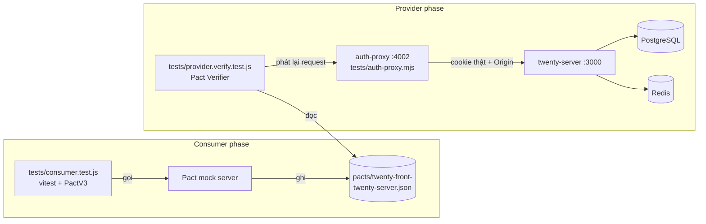

# Kiến trúc

## Hệ thống được kiểm thử
Twenty là CRM mã nguồn mở (monorepo TypeScript) quản lý People, Companies, Opportunities và đối tượng tùy biến theo workspace.
Đối tượng kiểm thử (SUT) là **image Docker đã pin**, không phải mã nguồn (xem [`VERSIONS.md`](../VERSIONS.md)).

| Thành phần | Vai trò | Với contract test |
|---|---|---|
| `twenty-front` (React) | Giao diện, gửi truy vấn GraphQL | **Consumer** |
| `twenty-server` (NestJS) | Cung cấp `/graphql` (dữ liệu) và `/metadata` (schema, người dùng hiện tại), xác thực, truy cập DB | **Provider** |
| PostgreSQL 16 | Lưu dữ liệu workspace | Hạ tầng của provider |
| Redis | Cache, hàng đợi | Hạ tầng của provider |
| `twenty-worker` | Xử lý tác vụ nền (cùng image, lệnh `yarn worker:prod`) | Ngoài phạm vi |

Cổng mặc định: server `3000`. Mặc định Docker Compose dựng 4 dịch vụ: `server`, `worker`, `db`, `redis`.

## Hai endpoint GraphQL
| Endpoint | Dùng cho | Interaction |
|---|---|---|
| `POST /graphql` | Dữ liệu bản ghi (People, Companies, Opportunities, mutation) | I-01, I-02, I-03, I-04, I-06, I-07 |
| `POST /metadata` | Metadata, người dùng hiện tại | I-05 |

Điểm cần biết khi viết hợp đồng:
- **Xác thực bằng cookie** `twenty-session=sess_...`, không có header `Authorization`.
- **Chống CSRF:** request dùng cookie mà thiếu `Origin` hợp lệ bị trả `403` với `error: CSRF_ORIGIN_MISMATCH`.
- **Lỗi GraphQL trả HTTP 200** kèm `errors[]` (ví dụ phiên sai). Chỉ kiểm status code là không đủ.
- Truy vấn của front được **sinh động từ metadata** của workspace, nên hợp đồng phụ thuộc workspace cố định (`dlu-qa`).

## Vị trí của Pact


Auth-proxy tồn tại vì hợp đồng chứa phiên giả `valid-session` còn server cần phiên thật; proxy thay cookie và đặt Origin.
Hạn chế hiện tại của proxy: xem [known-issues.md](known-issues.md) (I-07).

## Luồng dữ liệu của các nghiệp vụ trong phạm vi
| Nghiệp vụ | Luồng | Interaction |
|---|---|---|
| Xem danh sách People | Trình duyệt → front → `FindManyPeople` → `/graphql` → kiểm tra phiên + Origin → PostgreSQL → `edges[].node` | I-01 |
| Xem Companies | `FindManyCompanies` → `/graphql` | I-02 |
| Tạo Person | `CreateOnePerson` (mutation) → `/graphql` → ghi PostgreSQL → trả bản ghi mới | I-03 |
| Xem Opportunities | `FindManyOpportunities` → `/graphql` | I-04 |
| Người dùng hiện tại | `GetCurrentUser` → `/metadata` | I-05 |
| Phiên sai / thiếu Origin | Cùng truy vấn I-01 với cookie sai hoặc không có Origin | I-06, I-07 |

## Cấu trúc repo
```
docker/         docker-compose.yml, .env.example (Twenty đã pin digest)
tests/
  consumer.test.js          Pact consumer test, sinh hợp đồng
  queries.js                Truy vấn/biến lấy từ request thật của twenty-front
  provider.verify.test.js   Pact Verifier chạy vào Twenty thật
  auth-proxy.mjs            Proxy thay cookie, đặt Origin (cổng 4002)
  mutate-proxy.mjs          Proxy sửa JSON response (đổi tên/xóa/đổi kiểu/thêm field) cho thí nghiệm phá hợp đồng (cổng 4001)
  experiments.mjs           Chạy M-0, M-2, M-3, M-4, M-6 và ghi bằng chứng vào logs/experiments/
  probe.mjs                 Consumer test thử nghiệm cũ (chỉ I-01), không thuộc luồng chính
pacts/          Hợp đồng JSON được sinh ra (commit để provider verify)
logs/           Log chạy, ảnh bằng chứng, kết quả probe; logs/experiments/ chứa kết quả thí nghiệm phá hợp đồng
docs/           Tài liệu này
```
