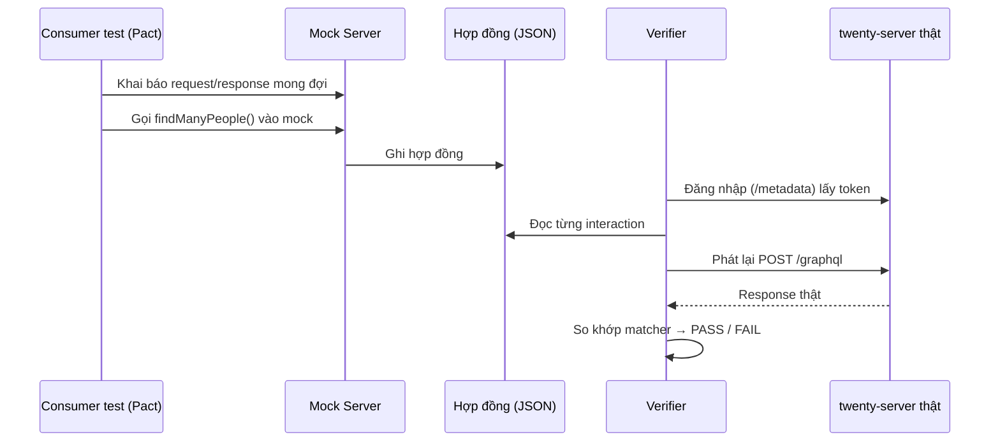

# BÁO CÁO TIẾN ĐỘ — KIỂM THỬ PHẦN MỀM

**Đề tài:** R10 (Twenty CRM) × K04 (Contract Testing với Pact)
**Nhóm:** R10 × K04 — Lớp CTK47B, Trường Đại học Đà Lạt
**Thành viên:** Phan Lê Xuân Mạnh - 2312686; Liêng Hót Ha Luyến - 2312682;Mai Quý Phước - 2312714
**Ngày báo cáo:** 13/10/2026 — **Mốc kế tiếp:** Milestone 2 ngày 20/10/2026

> **Ghi chú trung thực khi dùng:** toàn bộ số liệu/log trong tài liệu này lấy từ lần **chạy thử trong môi trường thử nghiệm** (Ubuntu 24.04, Twenty v2.8.3, PostgreSQL 16, Redis 7) vào ngày 12/10/2026, tức là *không phải* trên máy của nhóm. Khi báo cáo hãy nói đúng như vậy, hoặc chạy lại trên máy nhóm rồi thay ảnh/log ở Phụ lục B. Chỉ còn 4 chỗ **[ĐIỀN]** là thứ không thể suy ra (tên thành viên, link GitHub, ngày nộp, ảnh màn hình trên máy nhóm).

---

## 1. Tóm tắt (nói trong 30 giây)

Nhóm kiểm thử **Twenty CRM v2.8.3** (mã nguồn mở) bằng **kiểm thử hợp đồng (contract testing) với Pact**. Twenty gồm front-end React (`twenty-front`) và back-end NestJS (`twenty-server`) giao tiếp qua GraphQL; rủi ro là server đổi mà front chưa biết. Đến hôm nay nhóm đã: (1) clone mã nguồn đúng phiên bản, (2) dựng môi trường, (3) chạy được Twenty cục bộ, (4) thiết kế và chạy thử **một luồng kiểm thử hợp đồng** gồm 2 interaction.

| Hạng mục yêu cầu | Trạng thái | Bằng chứng |
|---|---|---|
| Clone repo | Xong (đã chạy thử) | `git describe --tags` → `v2.8.3`; `HEAD` = `5024f5497697…` (Phụ lục B.1) |
| Setup môi trường | Xong (đã chạy thử) | Node 24.5.0, Yarn 4.13.0, PostgreSQL 16.13, Redis 7.0.15 (mục 3) |
| Chạy được | Server chạy, `healthz` = `ok`, dữ liệu mẫu 1.200 People / 599 Companies / 50 Opportunities (Phụ lục B.1) | Ảnh trang People trên máy nhóm: [ĐIỀN] |
| Thiết kế 1 luồng kiểm thử | Xong, **đã chạy xanh** | `THIET_KE_LUONG_I01.md`, `twenty-pact-i01/`, log ở Phụ lục B.2 |

---

## 2. Bài toán và phạm vi

**Vì sao contract testing?** Kiểm thử E2E phải dựng cả hệ thống nên chậm và khó chỉ ra ai làm vỡ. Contract testing chỉ kiểm điểm nối giữa hai bên: *consumer* ghi lại những gì nó cần, *provider* được kiểm chứng xem còn đáp ứng không. Chạy trong vài giây và chỉ rõ bên nào vi phạm.

**Phân tích hệ thống (đã đọc mã nguồn v2.8.3):**

- Hai endpoint GraphQL: `/metadata` (đăng nhập 2 bước, metadata, người dùng hiện tại) và `/graphql` (dữ liệu bản ghi: People, Companies, Opportunities…). Ngoài ra có REST `/rest/...`.
- Câu query dữ liệu được front **sinh động từ metadata** (`generateFindManyRecordsQuery.ts`), nên khi viết hợp đồng phải cân nhắc phần nào để chặt, phần nào để lỏng.
- Danh mục ứng viên: **12 interaction** (6 ưu tiên P0, 6 ưu tiên P1) trong báo cáo cuối kỳ, mục 5.2.

**Xác định consumer / provider:** consumer = `twenty-front`; provider = `twenty-server`.

---

## 3. Môi trường đã dựng

| Thành phần | Giá trị |
|---|---|
| Hệ thống đích | Twenty **v2.8.3** (commit `5024f549…`, 26/05/2026) |
| Hệ điều hành | Windows + WSL2 (Ubuntu 24.04), repo đặt trong hệ tệp Linux |
| Node.js / Yarn | 24.5.0 / 4.13.0 (corepack) |
| CSDL / Cache | PostgreSQL 16 / Redis (cài trực tiếp bằng apt) |
| Cổng | Server `3000`, Front `3001` |
| Tài khoản dữ liệu mẫu | `tim@apple.dev` |
| Công cụ Pact | `@pact-foundation/pact` 17.1.4 (PactV3), vitest, Node ≥ 22 |

**Bằng chứng:** log lệnh thật ở Phụ lục B.1. Phiên bản hệ điều hành của lần chạy thử: Ubuntu 24.04.4 LTS. Ảnh màn hình trang People và `wsl -l -v` trên máy nhóm: [ĐIỀN].

**Khó khăn đã gặp và cách xử lý** (nói ngắn, thể hiện nhóm có làm thật):

- Ổ C đầy do ổ đĩa ảo WSL chỉ phình to không tự co lại → chuyển toàn bộ distro sang ổ D bằng `wsl --export/--import`.
- Docker Desktop tích hợp WSL không ổn định → bỏ Docker, cài PostgreSQL và Redis trực tiếp trong Ubuntu.
- Repo đặt trên `/mnt/d` rất chậm và dễ lỗi I/O → đặt repo trong `~/projects` (hệ tệp Linux).
- Đóng gói quy trình cài thành script (`2_dung_twenty.sh`, `3_chay_twenty.sh`) để mọi thành viên dựng lại giống nhau.

---

## 4. Luồng kiểm thử đã thiết kế: I-01 và I-06

**Thao tác người dùng:** đăng nhập → mở trang *People* → front gửi truy vấn `FindManyPeople`.



| | I-01 (luồng chính) | I-06 (luồng âm) |
|---|---|---|
| Điều kiện | Workspace có ít nhất 1 Person, token hợp lệ | Token sai |
| Request | `POST /graphql`, `FindManyPeople`, `variables {limit: 2}` | Như I-01 nhưng `Bearer token-sai` |
| Response mong đợi | HTTP 200; `edges` ≥ 1 phần tử gồm `id`, `name.firstName/lastName`, `city`; `totalCount`, `pageInfo` | HTTP **200**, `errors[0].extensions.code = UNAUTHENTICATED` |
| Chặt / lỏng | Chặt `operationName`, `variables`; lỏng `query` (regex); kiểm **kiểu** dữ liệu | Chặt mã lỗi |

**Nguyên tắc thiết kế hợp đồng:** chỉ chứa field mà consumer thực sự dùng; so khớp theo kiểu chứ không theo giá trị cụ thể.

---

## 5. Kết quả đã có

- Consumer test: **2/2 pass**, sinh file hợp đồng `pacts/twenty-front-twenty-server.json`.
- Provider verification vào Twenty v2.8.3 thật: **2/2 interaction OK** (log ở Phụ lục B.2).
- **Thí nghiệm phá hợp đồng:** đổi `city` thành `cityName` ở phía consumer, mô phỏng provider đổi tên field → provider báo `FAILED` với thông báo `missing the following keys: city`. Chứng minh hợp đồng phát hiện được thay đổi gây vỡ.

**Phát hiện kỹ thuật** (dùng làm điểm nhấn):

1. Lỗi xác thực của GraphQL trả **HTTP 200** kèm `errors`, không phải 401; hợp đồng phải mô tả đúng hành vi này.
2. `/graphql` trả `null` cho field không tồn tại thay vì báo lỗi, nên đổi tên field có thể âm thầm làm hỏng front; hợp đồng bắt được chỗ này.
3. Regex trong Pact phải neo `^…$`, nếu không mock server báo không khớp.
4. Pact không dùng được khi có biến môi trường proxy (Verifier bỏ qua `NO_PROXY`, gọi localhost bị 403).

---

## 6. Hạn chế hiện tại (nói thẳng)

- Mới có **2 interaction**; yêu cầu K04 là **≥ 5**.
- Câu query trong test là **bản rút gọn** theo cấu trúc mã nguồn, chưa đối chiếu với request thật từ DevTools.
- Mới thử với thao tác đọc; thao tác ghi cần Provider State thật.
- Hợp đồng chỉ kiểm hình dạng dữ liệu, không kiểm nghiệp vụ hay hiệu năng.
- Token đăng nhập hết hạn nhanh nên phải lấy mới mỗi lần verify.

---

## 7. Kế hoạch tiếp theo

| Thời gian | Công việc | Đầu ra |
|---|---|---|
| Đến 20/10 (Milestone 2) | Chụp request thật bằng DevTools, đối chiếu và chỉnh I-01/I-06; thêm I-02 `FindManyCompanies`, I-05 `GetCurrentUser` | ≥ 4 interaction, log chạy |
| Đến 27/10 | Thêm I-03 `CreateOnePerson`, I-04 `UpdateOneOpportunity` kèm Provider State | ≥ 5–6 interaction |
| Đến 03/11 | Thí nghiệm phá hợp đồng cho từng interaction; thống kê độ phủ | Bảng độ phủ, bằng chứng bắt lỗi |
| Đến 06/11 | Hoàn thiện báo cáo cuối kỳ, đẩy GitHub, chuẩn bị demo | Báo cáo + repo + demo |

*(Các mốc giữa 20/10 và 06/11 là dự kiến của nhóm; điều chỉnh theo lịch thực tế. Hạn nộp báo cáo chính thức: [ĐIỀN sau khi hỏi giảng viên].)*

**Rủi ro:** query sinh động khó khớp; token hết hạn; không tìm ra lỗi thật của Twenty (khi đó nhóm chứng minh độ phủ và khả năng phát hiện qua thí nghiệm phá hợp đồng, theo rubric K04).

---

## 8. Phân công

| Thành viên | Công việc |
|---|---|
*(Đề xuất để nhóm xác nhận lại, không phải phân công đã chốt.)*

| Thành viên | Công việc đề xuất |
|---|---|
| Luyen (2312682) | Môi trường và luồng I-01/I-06; tích hợp mã Pact; đẩy GitHub |
| [ĐIỀN: thành viên 2] | Thêm I-02, I-05 (đọc dữ liệu, thông tin người dùng); chụp request bằng DevTools |
| [ĐIỀN: thành viên 3] | Thêm I-03, I-04 (ghi dữ liệu, Provider State); thí nghiệm phá hợp đồng; viết báo cáo cuối kỳ |

---

## 9. Đề nghị với giảng viên

1. Xác nhận ngày nộp báo cáo cuối kỳ và định dạng nộp.
2. Milestone 2 (20/10) yêu cầu demo trực tiếp hay chỉ báo cáo kết quả?
3. Với K04, nếu không tìm được lỗi thật của Twenty, tiêu chí chứng minh độ phủ có đủ không?

---

## Phụ lục B. Log chạy thử (12/10/2026, môi trường thử nghiệm Ubuntu 24.04)

### B.1 Clone, môi trường, server

```text
$ git describe --tags
v2.8.3
$ git rev-parse HEAD
5024f5497697ecf42f23cf66ede941c0eb4eaacb      (ngày commit 2026-05-26)
$ node -v        → v24.5.0        (.nvmrc = 24.5.0)
$ yarn -v        → 4.13.0         (packageManager = yarn@4.13.0)
$ psql --version → PostgreSQL 16.13 (Ubuntu 24.04)
$ redis-server --version → Redis 7.0.15
```

```text
$ curl localhost:3000/healthz
{"status":"ok","info":{},"error":{},"details":{}}

$ node src/auth.js | cut -c1-40
eyJhbGciOiJFUzI1NiIsInR5cCI6IkpXVCIsImtp

$ seed counts (GraphQL totalCount)
people: {"data":{"people":{"totalCount":1200}}}
companies: {"data":{"companies":{"totalCount":599}}}
opportunities: {"data":{"opportunities":{"totalCount":50}}}

$ I-01 real response (first=1)
{"data":{"people":{"edges":[{"node":{"id":"20202020-b000-4485-94de-70c2a98daef2","name":{"firstName":"Jeffery","lastName":"Griffin"},"city":"New Jennifer"},"cursor":"eyJpZCI6IjIwMjAyMDIwLWIwMDAtNDQ4NS05NGRlLTcwYzJhOThkYWVmMiJ9"}],"pageInfo":{"hasNextPage":true,"hasPreviousPage":false,"startCursor":"eyJpZCI6IjIwMjAyMDIwLWIwMDAtNDQ4NS05NGRlLTcwYzJhOThkYWVmMiJ9","endCursor":"eyJpZCI6IjIwMjAyMDIwLWIwMDAtNDQ4NS05NGRlLTcwYzJhOThkYWVmMiJ9"},"totalCount":1200}}}


$ I-06 real response (token sai)
HTTP/1.1 200 OK
{"errors":[{"message":"No payload","extensions":{"userFriendlyMessage":{"id":"z+7x/s","message":"You must be authenticated to perform this action."},"subCode":"UNAUTHENTICATED","code":"UNAUTHENTICATED"}}]}
```

### B.2 Chạy luồng kiểm thử Pact

```text
$ npm run test:consumer
 RUN  v5.0.4 /tmp/claude-0/-home-claude/8f9f864d-89ff-5c3e-be42-459c9d0ee840/scratchpad/tp
 Test Files  1 passed (1)
      Tests  2 passed (2)
   Start at  21:23:05
   Duration  2.02s (import 94%, tests 5%)

$ npm run test:provider
 RUN  v5.0.4 /tmp/claude-0/-home-claude/8f9f864d-89ff-5c3e-be42-459c9d0ee840/scratchpad/tp
Verifying a pact between twenty-front and twenty-server
  I-01 FindManyPeople với access token hợp lệ (0s loading, 48ms verification)
     Given workspace có ít nhất 1 Person
    returns a response which
      has status code 200 (OK)
      includes headers
        "Content-Type" with value "application/json; charset=utf-8" (OK)
      has a matching body (OK)
  I-06 FindManyPeople với access token sai (0s loading, 11ms verification)
     Given token không hợp lệ
    returns a response which
      has status code 200 (OK)
      includes headers
        "Content-Type" with value "application/json; charset=utf-8" (OK)
      has a matching body (OK)
 Test Files  1 passed (1)
      Tests  1 passed (1)
   Start at  21:23:08
   Duration  725ms (import 55%, tests 43%, worker 1%, transform 1%)

$ npm run break:rename-field
      Tests  2 passed (2)
   Start at  21:23:09
   Duration  494ms (import 85%, tests 12%, worker 1%, transform 1%)
  I-01 FindManyPeople với access token hợp lệ (2ms loading, 60ms verification)
      has status code 200 (OK)
        "Content-Type" with value "application/json; charset=utf-8" (OK)
      has a matching body (FAILED)
  I-06 FindManyPeople với access token sai (2ms loading, 13ms verification)
      has status code 200 (OK)
        "Content-Type" with value "application/json; charset=utf-8" (OK)
      has a matching body (OK)
Failures:
1) Verifying a pact between twenty-front and twenty-server Given workspace có ít nhất 1 Person - I-01 FindManyPeople với access token hợp lệ
           $.data.people.edges[0].node -> Actual map is missing the following keys: city
           $.data.people.edges[1].node -> Actual map is missing the following keys: city
There were 1 pact failures
     × xác minh I-01 và I-06 271ms
⎯⎯⎯⎯⎯⎯⎯ Failed Tests 1 ⎯⎯⎯⎯⎯⎯⎯
 FAIL  tests/provider.verify.test.js > twenty-server thật thỏa mãn hợp đồng của twenty-front > xác minh I-01 và I-06
      Tests  1 failed (1)

$ khôi phục: npm run test:consumer && npm run test:provider
      Tests  2 passed (2)
      Tests  1 passed (1)
```

Giải thích dòng cuối: sau thí nghiệm phá hợp đồng, chạy lại `test:consumer` rồi `test:provider` thì quay về xanh (2 passed / 1 passed).

---

## Phụ lục: tài liệu kèm theo

- `THIET_KE_LUONG_I01.md` — đặc tả đầy đủ luồng I-01/I-06
- `twenty-pact-i01/` — mã nguồn test (consumer, provider, lấy token)
- `BaoCao_CuoiKy_R10_K04_ban_nhap.md` — bản nháp báo cáo cuối kỳ
- Repo GitHub của nhóm: [ĐIỀN: link sau khi đẩy lên]
