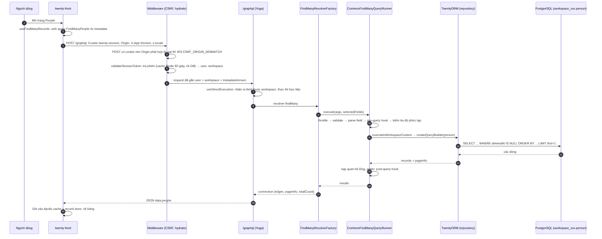
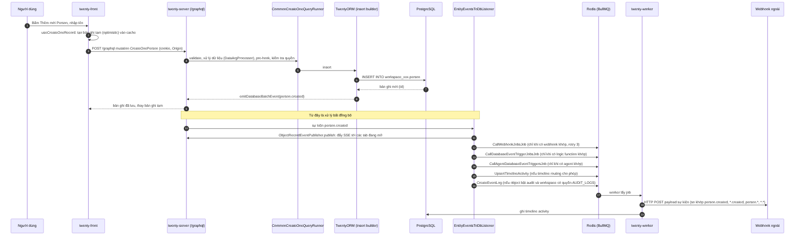
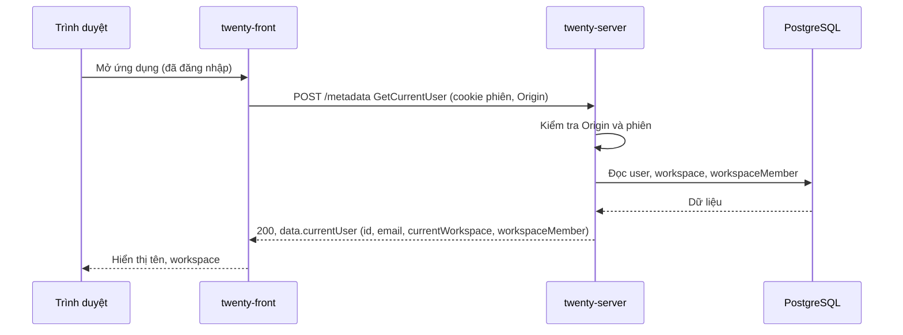

# A. Mô tả hệ thống

## A.1 Mục tiêu hệ thống
Twenty là phần mềm CRM (quản lý quan hệ khách hàng) mã nguồn mở, được xem là phương án thay thế Salesforce.
Nó giúp một nhóm kinh doanh lưu và theo dõi:
- **People**: từng khách hàng, liên hệ.
- **Companies**: công ty mà các liên hệ thuộc về.
- **Opportunities**: cơ hội bán hàng (deal), gồm giá trị và ngày dự kiến chốt.

Ngoài ra còn ghi chú, tác vụ, quy trình tự động, và cho phép mỗi workspace tự thêm đối tượng và field riêng.
Nhóm kiểm thử phần giao tiếp giữa giao diện và máy chủ của hệ thống này (xem phần B, D).

## A.2 Actor và use case chính
| Actor | Use case |
|---|---|
| Người dùng workspace (nhân viên kinh doanh) | Đăng nhập; xem danh sách People, Companies, Opportunities; tạo bản ghi mới (ví dụ Person); xem thông tin tài khoản của mình |
| Quản trị workspace | Mời và quản lý thành viên; cấu hình đối tượng và field tùy biến |
| Hệ thống ngoài | Gọi API hoặc nhận webhook (ngoài phạm vi kiểm thử của nhóm) |

Các use case nằm trong phạm vi kiểm thử, kèm interaction tương ứng ([`docs/interactions.md`](../interactions.md)):

| Use case | Interaction |
|---|---|
| Xem danh sách People | I-01 |
| Xem danh sách Companies | I-02 |
| Tạo Person | I-03 |
| Xem danh sách Opportunities | I-04 |
| Lấy người dùng hiện tại | I-05 |
| Truy cập với phiên sai | I-06 |
| Truy cập thiếu Origin (chống CSRF) | I-07 |

## A.3 Cấu trúc thư mục và dependency

### Monorepo Twenty (đối tượng được kiểm thử)
Twenty là monorepo Nx/Yarn gồm 19 gói trong `packages/`. Mức 2 của cây thư mục, rút gọn theo các gói liên quan:

```
twenty/                       (tag sdk/v2.46.0, commit 9070979)
└── packages/
    ├── twenty-front/         SPA React, gửi truy vấn GraphQL           ← CONSUMER
    ├── twenty-server/        NestJS, /graphql và /metadata, xác thực    ← PROVIDER
    │   └── src/
    │       ├── engine/       middleware (CSRF, cookie), api, core-modules, metadata-modules
    │       ├── modules/      nghiệp vụ CRM: person, company, opportunity, ...
    │       └── queue-worker/ điểm vào của worker (chạy nền)
    ├── twenty-shared/        kiểu và hằng số dùng chung
    ├── twenty-ui/            thư viện component giao diện
    ├── twenty-emails/        mẫu email
    ├── twenty-sdk, twenty-client-sdk/   SDK cho ứng dụng mở rộng
    ├── twenty-e2e-testing/   Playwright
    └── twenty-docker/        Dockerfile, docker-compose
```
Front và server **không phụ thuộc trực tiếp vào nhau**; chúng chỉ gặp nhau qua giao thức GraphQL và cookie phiên. Đó là ranh giới để đặt hợp đồng Pact.
Nhóm không chạy từ mã nguồn mà chạy image Docker đã pin; mã nguồn chỉ để đọc hiểu (xem [`VERSIONS.md`](../../VERSIONS.md)).
Nguồn số liệu: phân tích mã tag chính thức của nhóm ở giai đoạn 1. **Lưu ý:** cây trên là bản rút gọn từ phân tích đó, chưa chạy lại `tree -L 2` trên bản clone; nếu cần ảnh `tree` thật thì chạy trên bản clone của tag này.

### Repo của nhóm (bộ kiểm thử Pact)
```
twenty-pact-contract-testing/
├── docker/        docker-compose.yml (Twenty, PostgreSQL, Redis đã pin digest), .env.example
├── tests/         consumer.test.js, provider.verify.test.js, queries.js,
│                  auth-proxy.mjs, mutate-proxy.mjs, experiments.mjs, run-all.mjs
├── pacts/         hợp đồng JSON được sinh ra
├── logs/          log chạy, ảnh bằng chứng, kết quả thí nghiệm
├── docs/          tài liệu, báo cáo
├── slides/        slide thuyết trình (Slidev)
├── package.json, VERSIONS.md, README.md, TASKS.md
```

### Dependency chính
| Thành phần | Phiên bản | Dùng để | Nguồn |
|---|---|---|---|
| Twenty (server, worker) | `twentycrm/twenty:v2.46.0` (pin digest) | Hệ thống được kiểm thử | `VERSIONS.md`, `docker/docker-compose.yml` |
| PostgreSQL | 16 (pin digest) | Lưu dữ liệu workspace | `docker/docker-compose.yml` |
| Redis | pin digest | Cache, hàng đợi | `docker/docker-compose.yml` |
| Node.js | ≥ 22 | Chạy bộ test | `docs/setup.md` |
| `@pact-foundation/pact` | 16.5.0 (`^16.0.0`) | Consumer test, Pact Verifier | `package.json`, `package-lock.json` |
| `vitest` | 3.2.7 (`^3.0.0`) | Chạy test | `package.json`, `package-lock.json` |
| `cross-env`, `rimraf` | `^7.0.3`, `^6.0.0` | Tiện ích cho script npm | `package.json` |

Dependency bên trong Twenty (NestJS 11, GraphQL Yoga, TypeORM, BullMQ, React 19, Apollo Client 4, ...) do image đóng gói, nhóm không can thiệp.

## A.4 Luồng dữ liệu của các nghiệp vụ trọng tâm

### F1. Xem danh sách People (I-01)


Tóm tắt từng bước:
1. Người dùng mở trang People.
2. `twenty-front` dựng truy vấn `FindManyPeople` từ metadata của workspace và gửi `POST /graphql` kèm cookie phiên `twenty-session`, header `Origin` và `x-app-version`.
3. `twenty-server` kiểm tra Origin (chống CSRF) và phiên; nếu hợp lệ thì chạy truy vấn trên PostgreSQL.
4. Server trả `data.people` gồm `edges[].node` (`id`, `name`, `emails`, `jobTitle`), `pageInfo` và `totalCount`.

Xem Companies (I-02) và Opportunities (I-04) đi theo đúng luồng này, chỉ khác tên truy vấn (`FindManyCompanies`, `FindManyOpportunities`).

### F2. Tạo Person (I-03)


Tóm tắt từng bước:
1. Người dùng bấm thêm mới Person; front gửi mutation `CreateOnePerson` tới `/graphql`.
2. Server kiểm tra phiên và Origin, ghi bản ghi vào PostgreSQL.
3. Server trả bản ghi mới (có `id`, `name`, `emails`, `jobTitle`, `position`, `createdAt`, `createdBy`).
4. Sau khi ghi, server còn phát sự kiện bất đồng bộ qua Redis cho worker (webhook, timeline); phần này ngoài phạm vi kiểm thử.

Vì I-03 ghi dữ liệu thật nên provider state phải dọn fixture trước và sau mỗi lượt verify ([`docs/interactions.md`](../interactions.md)).

### F3. Lấy người dùng hiện tại (I-05)

Khác với F1, F2, luồng này đi qua endpoint `/metadata` thay vì `/graphql`.

### F4. Phiên sai và thiếu Origin (I-06, I-07)
| Tình huống | Hành vi thật của Twenty v2.46.0 | Interaction |
|---|---|---|
| Cookie phiên sai | HTTP **200** kèm `errors[]` (không phải 401) | I-06 |
| Có cookie nhưng không có Origin hợp lệ | HTTP **403**, `error: CSRF_ORIGIN_MISMATCH` | I-07 |

Nguồn: [`docs/architecture.md`](../architecture.md), [`docs/interactions.md`](../interactions.md), [`docs/archive/bao_cao_giua_ky_milestone_2.md`](../archive/bao_cao_giua_ky_milestone_2.md) mục A, phân tích mã nguồn giai đoạn 1 (sơ đồ luồng lấy từ đó).
