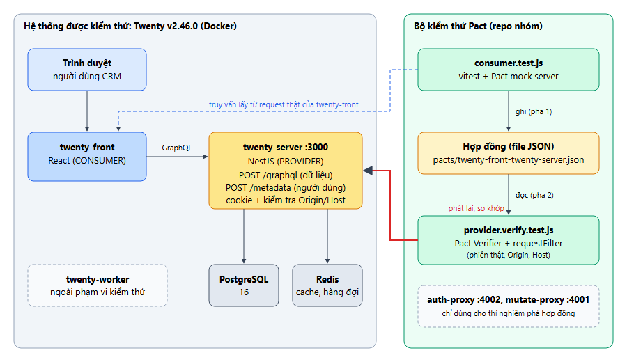

# B. Kiến trúc hệ thống

## B.1 Sơ đồ kiến trúc và vị trí của Pact

(Bản vector: [`img/kien-truc.svg`](img/kien-truc.svg).)

Cách đọc sơ đồ:
- **Khung trái** là hệ thống được kiểm thử, chạy bằng Docker từ image Twenty `v2.46.0` đã pin theo digest (xem [`VERSIONS.md`](../../VERSIONS.md)).
  Người dùng thao tác trên trình duyệt; `twenty-front` gửi truy vấn GraphQL tới `twenty-server`, server đọc/ghi PostgreSQL và dùng Redis làm cache, hàng đợi.
- **Khung phải** là bộ kiểm thử của nhóm. Pha 1 (consumer): `consumer.test.js` chạy với Pact mock server và ghi ra file hợp đồng JSON.
  Pha 2 (provider): `provider.verify.test.js` đọc hợp đồng, phát lại từng request lên `twenty-server` thật ở `:3000` và so khớp response.
- Đường nét đứt xanh: truy vấn trong hợp đồng được lấy từ request thật của `twenty-front` (DevTools), không tự viết.
- `auth-proxy` và `mutate-proxy` không nằm trên đường verify chính; chỉ dùng cho thí nghiệm phá hợp đồng ([`docs/testing.md`](../testing.md)).

## B.2 Các module liên quan trực tiếp tới kiểm thử

| Module | Giải thích | Vì sao liên quan |
|---|---|---|
| `twenty-front` (React) | Giao diện; sinh truy vấn GraphQL như `FindManyPeople`, `CreateOnePerson`, `GetCurrentUser` | Là **consumer**: truy vấn của nó xác định field nào thật sự được dùng, tức nội dung hợp đồng |
| `twenty-server` — `POST /graphql` | Điểm vào cho dữ liệu bản ghi (People, Companies, Opportunities, mutation) | Là **provider** của 6 trong 7 interaction (I-01 đến I-04, I-06, I-07) |
| `twenty-server` — `POST /metadata` | Metadata và người dùng hiện tại | Là provider của I-05; schema được sinh động theo workspace nên dễ phát sinh breaking change |
| Xác thực cookie và chống CSRF | Phiên nằm trong cookie `twenty-session=sess_...`; request dùng cookie mà thiếu Origin hợp lệ bị `403 CSRF_ORIGIN_MISMATCH`; Twenty đối chiếu Origin với Host (bài học KI-4) | Quyết định HTTP 200 hay 403; I-06 (phiên sai, HTTP 200 kèm `errors[]`) và I-07 (thiếu Origin, 403) kiểm đúng hành vi này |
| PostgreSQL 16 và dữ liệu mẫu | Lưu dữ liệu workspace; tối thiểu 1 Person, 1 Company, 1 Opportunity ([`docs/setup.md`](../setup.md) mục 2) | Là nền cho **provider state**: precondition của mỗi interaction thật sự phụ thuộc dữ liệu này |
| Pact (consumer test, Verifier, provider state) | `@pact-foundation/pact` 16.x chạy trong vitest; provider state handler kiểm precondition và dọn fixture I-03 | Là công cụ tạo và kiểm chứng hợp đồng |

## B.3 Điểm cần lưu ý về kiến trúc khi viết hợp đồng
- Lỗi GraphQL trả **HTTP 200** kèm `errors[]`, nên chỉ kiểm status code là không đủ (I-06).
- Verifier phát lại request với `Host` khác, nên `requestFilter` phải đặt lại `Host` và `Origin`, nếu không 5 interaction dùng phiên hợp lệ bị 403 (KI-4, [`docs/known-issues.md`](../known-issues.md)).
- Đối tượng kiểm thử là **image Docker đã pin**, không phải mã nguồn; kết quả không phụ thuộc source đối chiếu.

Nguồn: [`docs/architecture.md`](../architecture.md), [`docs/interactions.md`](../interactions.md), [`docs/known-issues.md`](../known-issues.md).
