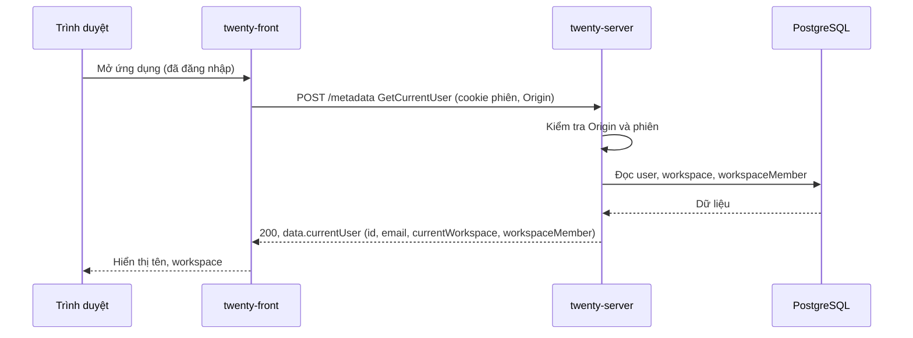

# BÁO CÁO CUỐI KỲ: CONTRACT TESTING (PACT) CHO TWENTY CRM

Môn Kiểm thử Phần mềm, ĐH Đà Lạt. GV: Nguyễn Thế Lâm. Nhóm 12. Đề tài R10 (Twenty CRM) × K04 (Contract Testing, Pact).
Thành viên: Phan Lê Xuân Mạnh (2312686), Liêng Hót Ha Luyến (2312682), Mai Quý Phước (2312716).
Repo: https://github.com/xuanmanhneee/twenty-pact-contract-testing · Tag nộp: [NHÓM ĐIỀN]

---

## 0. Tóm tắt
Nhóm áp dụng consumer-driven contract testing bằng Pact lên cặp `twenty-front` (consumer) và `twenty-server` (provider) của Twenty CRM v2.46.0. Hợp đồng gồm **7 interaction**: 4 thao tác đọc, ghi dữ liệu nghiệp vụ, 1 thao tác lấy người dùng hiện tại và 2 ca bị từ chối. Truy vấn lấy từ request thật của twenty-front.
Kết quả đo lại ngày 28/11/2026: consumer **7/7**, Verifier gọi thẳng Twenty thật **7/7** (cả 7 lượt đều đạt). Năm thí nghiệm phía provider (đối chứng, đổi tên, xóa field, đổi kiểu, thêm field) chạy **6 lượt, lượt nào cũng đúng kỳ vọng**. Thí nghiệm phía consumer làm fail đúng 1 interaction bị sửa hợp đồng.
Trong quá trình làm, nhóm tìm ra và xử lý bốn vấn đề của bộ kiểm thử (KI-1 đến KI-4). Trong phạm vi đã kiểm, nhóm chưa phát hiện lỗi của Twenty; mục G.4 và G.5 trình bày bằng chứng thay thế.

## 1. Phân công và đóng góp
| Thành viên | Phần việc chính (theo commit và checklist) | Commit tiêu biểu | Số commit |
|---|---|---|---|
| Phan Lê Xuân Mạnh (2312686) | Dựng Docker và pin phiên bản; baseline Pact; provider verify; sửa KI-1 đến KI-4; provider state và teardown; thí nghiệm phía provider; `npm run all`; tài liệu, slide, kịch bản demo | `f52e2cc`, `835e008`, `9b65561`, `c696b6a`, `757e3d3`, `9068c96`, `7a06b58` | 28 |
| Mai Quý Phước (2312716) | Bắt request thật bằng Chromium; consumer test I-02 đến I-05, I-07; hàm dùng chung; log, số liệu, thí nghiệm `BREAK=1` trên bộ 6 interaction | `59935b1`, `50ede89`, `f50dff1`, `3c4d785`, `d91dbf9`, `1b43d3b` | 6 |
| Liêng Hót Ha Luyến (2312682) | Phân tích hệ thống, kiến trúc, sơ đồ và luồng dữ liệu (phần A, B); cơ sở lý thuyết, phạm vi, rủi ro, tiêu chí pass/fail (phần D); dựng Twenty bằng Docker; chạy lại trên môi trường mới; bổ sung hướng dẫn cài đặt; gộp báo cáo | `bc99d54`, `1efad54`, `2b19051`, `e4ac3bd`, `0ad3d84`, `7f30b8f`, `760ad65`, `08ccaf4` | 17 |

Số commit đếm trên nhánh `2312682_HaLuyen` đến commit `08ccaf4` (28/11/2026), chưa gồm các commit cập nhật báo cáo sau đó. Commit của Mạnh tập trung ở ngày 19/10 và 21/11, của Phước ở ngày 16/11, của Luyến ở ngày 24/11 và 28/11. Số commit không phản ánh khối lượng công việc.

Tỷ lệ đóng góp và nhận xét chéo: nộp trong bản phân công và peer review riêng. Công cụ quản lý công việc (Trello/Jira/GitHub Projects): [NHÓM ĐIỀN link]. Danh sách việc trong repo: `TASKS.md`.

---

# PHẦN I. PHÂN TÍCH HỆ THỐNG VÀ MÔI TRƯỜNG

## A. Mô tả hệ thống

### A.1 Mục tiêu hệ thống
Twenty là phần mềm CRM (quản lý quan hệ khách hàng) mã nguồn mở, được xem là phương án thay thế Salesforce.
Nó giúp một nhóm kinh doanh lưu và theo dõi:
- **People**: từng khách hàng, liên hệ.
- **Companies**: công ty mà các liên hệ thuộc về.
- **Opportunities**: cơ hội bán hàng (deal), gồm giá trị và ngày dự kiến chốt.

Ngoài ra còn ghi chú, tác vụ, quy trình tự động, và cho phép mỗi workspace tự thêm đối tượng và field riêng.
Nhóm kiểm thử phần giao tiếp giữa giao diện và máy chủ của hệ thống này (xem phần B, D).

### A.2 Actor và use case chính
| Actor | Use case |
|---|---|
| Người dùng workspace (nhân viên kinh doanh) | Đăng nhập; xem danh sách People, Companies, Opportunities; tạo bản ghi mới (ví dụ Person); xem thông tin tài khoản của mình |
| Quản trị workspace | Mời và quản lý thành viên; cấu hình đối tượng và field tùy biến |
| Hệ thống ngoài | Gọi API hoặc nhận webhook (ngoài phạm vi kiểm thử của nhóm) |

Các use case nằm trong phạm vi kiểm thử, kèm interaction tương ứng ([`docs/interactions.md`](../interactions.md)):

| Use case | Interaction |
|---|---|
| Xem danh sách People | I-01 |
| Xem danh sách Companies | I-02 |
| Tạo Person | I-03 |
| Xem danh sách Opportunities | I-04 |
| Lấy người dùng hiện tại | I-05 |
| Truy cập với phiên sai | I-06 |
| Truy cập thiếu Origin (chống CSRF) | I-07 |

### A.3 Cấu trúc thư mục và dependency

#### Monorepo Twenty (đối tượng được kiểm thử)
Twenty là monorepo Nx/Yarn gồm 21 gói trong `packages/`. Dưới đây là đủ 21 gói ở mức 2; riêng hai gói liên quan được mở thêm thư mục `src/`:

```
twenty/                       (tag sdk/v2.46.0, commit 9070979)
└── packages/
    ├── twenty-front/         SPA React            <- CONSUMER
    │   └── src/  config, generated, generated-admin, generated-metadata,
    │             hooks, loading, locales, modules, pages, testing,
    │             types, utils
    ├── twenty-server/        NestJS               <- PROVIDER
    │   └── src/  command, constants, database, engine, filters, modules,
    │             queue-worker, utils, main.ts, app.module.ts, instrument.ts
    ├── twenty-shared/, twenty-ui/, twenty-emails/, twenty-utils/
    ├── twenty-sdk/, twenty-client-sdk/, twenty-cli/, create-twenty-app/
    ├── twenty-e2e-testing/, twenty-docker/, twenty-docs/, twenty-website/
    ├── twenty-apps/, twenty-companion/, twenty-zapier/
    ├── twenty-front-component-renderer/, twenty-oxlint-rules/
    └── twenty-agent-skills/, twenty-claude-skills/
```
Trong `twenty-server/src`, `engine/` chứa phần nền (`api`, `middlewares`, `guards`, `core-modules`, `metadata-modules`), còn `modules/` chứa nghiệp vụ CRM (`person`, `company`, `opportunity`, ...).
Front và server **không phụ thuộc trực tiếp vào nhau**; chúng chỉ gặp nhau qua giao thức GraphQL và cookie phiên. Đó là ranh giới để đặt hợp đồng Pact.
Nhóm không chạy từ mã nguồn mà chạy image Docker đã pin; mã nguồn chỉ để đọc hiểu (xem [`VERSIONS.md`](../../VERSIONS.md)).
Nguồn: danh sách thư mục lấy bằng `git ls-tree` trên tag `sdk/v2.46.0` của `twentyhq/twenty` (28/11/2026).

#### Repo của nhóm (bộ kiểm thử Pact)
```
twenty-pact-contract-testing/
├── docker/        docker-compose.yml (Twenty, PostgreSQL, Redis đã pin digest), .env.example
├── tests/         consumer.test.js, provider.verify.test.js, queries.js,
│                  auth-proxy.mjs, mutate-proxy.mjs, experiments.mjs, run-all.mjs
├── pacts/         hợp đồng JSON được sinh ra
├── logs/          log chạy, ảnh bằng chứng, kết quả thí nghiệm
├── docs/          tài liệu, báo cáo
├── slides/        slide thuyết trình (Slidev)
├── package.json, VERSIONS.md, README.md, TASKS.md
```

#### Dependency chính
| Thành phần | Phiên bản | Dùng để | Nguồn |
|---|---|---|---|
| Twenty (server, worker) | `twentycrm/twenty:v2.46.0` (pin digest) | Hệ thống được kiểm thử | `VERSIONS.md`, `docker/docker-compose.yml` |
| PostgreSQL | 16 (pin digest) | Lưu dữ liệu workspace | `docker/docker-compose.yml` |
| Redis | pin digest | Cache, hàng đợi | `docker/docker-compose.yml` |
| Node.js | ≥ 22 | Chạy bộ test | `docs/setup.md` |
| `@pact-foundation/pact` | 16.5.0 (`^16.0.0`) | Consumer test, Pact Verifier | `package.json`, `package-lock.json` |
| `vitest` | 3.2.7 (`^3.0.0`) | Chạy test | `package.json`, `package-lock.json` |
| `cross-env`, `rimraf` | `^7.0.3`, `^6.0.0` | Tiện ích cho script npm | `package.json` |

Dependency bên trong Twenty (NestJS 11, GraphQL Yoga, TypeORM, BullMQ, React 19, Apollo Client 4, ...) do image đóng gói, nhóm không can thiệp.

### A.4 Luồng dữ liệu của các nghiệp vụ trọng tâm

#### Xem danh sách People (I-01)


Tóm tắt từng bước:
1. Người dùng mở trang People.
2. `twenty-front` dựng truy vấn `FindManyPeople` từ metadata của workspace và gửi `POST /graphql` kèm cookie phiên `twenty-session`, header `Origin` và `x-app-version`.
3. `twenty-server` kiểm tra Origin (chống CSRF) và phiên; nếu hợp lệ thì chạy truy vấn trên PostgreSQL.
4. Server trả `data.people` gồm `edges[].node` (`id`, `name`, `emails`, `jobTitle`), `pageInfo` và `totalCount`.

Xem Companies (I-02) và Opportunities (I-04) đi theo đúng luồng này, chỉ khác tên truy vấn (`FindManyCompanies`, `FindManyOpportunities`).

#### Tạo Person (I-03)


Tóm tắt từng bước:
1. Người dùng bấm thêm mới Person; front gửi mutation `CreateOnePerson` tới `/graphql`.
2. Server kiểm tra phiên và Origin, ghi bản ghi vào PostgreSQL.
3. Server trả bản ghi mới (có `id`, `name`, `emails`, `jobTitle`, `position`, `createdAt`, `createdBy`).
4. Sau khi ghi, server còn phát sự kiện bất đồng bộ qua Redis cho worker (webhook, timeline); phần này ngoài phạm vi kiểm thử.

Vì I-03 ghi dữ liệu thật nên provider state phải dọn fixture trước và sau mỗi lượt verify ([`docs/interactions.md`](../interactions.md)).

#### Lấy người dùng hiện tại (I-05)

Khác với hai luồng trên, luồng này đi qua endpoint `/metadata` thay vì `/graphql`.

#### Phiên sai và thiếu Origin (I-06, I-07)
| Tình huống | Hành vi thật của Twenty v2.46.0 | Interaction |
|---|---|---|
| Cookie phiên sai | HTTP **200** kèm `errors[]` (không phải 401) | I-06 |
| Có cookie nhưng không có Origin hợp lệ | HTTP **403**, `error: CSRF_ORIGIN_MISMATCH` | I-07 |

Nguồn: [`docs/architecture.md`](../architecture.md), [`docs/interactions.md`](../interactions.md), [`docs/archive/bao_cao_giua_ky_milestone_2.md`](../archive/bao_cao_giua_ky_milestone_2.md) mục A, phân tích mã nguồn giai đoạn 1 (sơ đồ luồng lấy từ đó).

## B. Kiến trúc hệ thống

### B.1 Sơ đồ kiến trúc và vị trí của Pact


(Bản vector: [`img/kien-truc.svg`](img/kien-truc.svg).)

Cách đọc sơ đồ:
- **Khung trái** là hệ thống được kiểm thử, chạy bằng Docker từ image Twenty `v2.46.0` đã pin theo digest (xem [`VERSIONS.md`](../../VERSIONS.md)).
  Người dùng thao tác trên trình duyệt; `twenty-front` gửi truy vấn GraphQL tới `twenty-server`, server đọc/ghi PostgreSQL và dùng Redis làm cache, hàng đợi.
- **Khung phải** là bộ kiểm thử của nhóm. Pha 1 (consumer): `consumer.test.js` chạy với Pact mock server và ghi ra file hợp đồng JSON.
  Pha 2 (provider): `provider.verify.test.js` đọc hợp đồng, phát lại từng request lên `twenty-server` thật ở `:3000` và so khớp response.
- Đường nét đứt xanh: truy vấn trong hợp đồng được lấy từ request thật của `twenty-front` (DevTools), không tự viết.
- `auth-proxy` và `mutate-proxy` không nằm trên đường verify chính; chỉ dùng cho thí nghiệm phá hợp đồng ([`docs/testing.md`](../testing.md)).

### B.2 Các module liên quan trực tiếp tới kiểm thử

| Module | Giải thích | Vì sao liên quan |
|---|---|---|
| `twenty-front` (React) | Giao diện; sinh truy vấn GraphQL như `FindManyPeople`, `CreateOnePerson`, `GetCurrentUser` | Là **consumer**: truy vấn của nó xác định field nào thật sự được dùng, tức nội dung hợp đồng |
| `twenty-server` — `POST /graphql` | Điểm vào cho dữ liệu bản ghi (People, Companies, Opportunities, mutation) | Là **provider** của 6 trong 7 interaction (I-01 đến I-04, I-06, I-07) |
| `twenty-server` — `POST /metadata` | Metadata và người dùng hiện tại | Là provider của I-05; schema được sinh động theo workspace nên dễ phát sinh breaking change |
| Xác thực cookie và chống CSRF | Phiên nằm trong cookie `twenty-session=sess_...`; request dùng cookie mà thiếu Origin hợp lệ bị `403 CSRF_ORIGIN_MISMATCH`; Twenty đối chiếu Origin với Host (bài học KI-4) | Quyết định HTTP 200 hay 403; I-06 (phiên sai, HTTP 200 kèm `errors[]`) và I-07 (thiếu Origin, 403) kiểm đúng hành vi này |
| PostgreSQL 16 và dữ liệu mẫu | Lưu dữ liệu workspace; tối thiểu 1 Person, 1 Company, 1 Opportunity ([`docs/setup.md`](../setup.md) mục 2) | Là nền cho **provider state**: precondition của mỗi interaction thật sự phụ thuộc dữ liệu này |
| Pact (consumer test, Verifier, provider state) | `@pact-foundation/pact` 16.x chạy trong vitest; provider state handler kiểm precondition và dọn fixture I-03 | Là công cụ tạo và kiểm chứng hợp đồng |

### B.3 Điểm cần lưu ý về kiến trúc khi viết hợp đồng
- Lỗi GraphQL trả **HTTP 200** kèm `errors[]`, nên chỉ kiểm status code là không đủ (I-06).
- Verifier phát lại request với `Host` khác, nên `requestFilter` phải đặt lại `Host` và `Origin`, nếu không 5 interaction dùng phiên hợp lệ bị 403 (KI-4, [`docs/known-issues.md`](../known-issues.md)).
- Đối tượng kiểm thử là **image Docker đã pin**, không phải mã nguồn; kết quả không phụ thuộc source đối chiếu.

Nguồn: [`docs/architecture.md`](../architecture.md), [`docs/interactions.md`](../interactions.md), [`docs/known-issues.md`](../known-issues.md).

## C. Môi trường và bằng chứng chạy thành công
### C.1 Môi trường thực tế
| Thành phần | Phiên bản |
|---|---|
| Twenty server/worker | `twentycrm/twenty:v2.46.0` (pin digest `sha256:bb4e94f0...`, build 09/10/2026) |
| PostgreSQL | `postgres:16` (pin digest) |
| Redis | pin digest |
| Node.js | ≥ 22 (đã chạy với v26.13.0 và v22.18.0 trên Windows 11) |
| Pact | `@pact-foundation/pact` 16.5.0 |
| Test runner | vitest 3.x |
Nguồn: `VERSIONS.md` (digest đầy đủ). Source tham chiếu: tag `sdk/v2.46.0` (commit `9070979`, 09/10/2026, trùng ngày build image); image không công bố commit nên chưa chứng minh khớp từng byte, kết quả không phụ thuộc source.

### C.2 Hướng dẫn dựng hệ thống
1. `cd docker && cp .env.example .env`, điền các giá trị `CHANGE_ME` (mật khẩu PostgreSQL, khóa mã hóa sinh bằng `openssl rand -base64 32`); `docker compose up -d`; kiểm tra `curl http://localhost:3000/healthz`.
2. Mở http://localhost:3000, tạo tài khoản và workspace (đề nghị tên `dlu-qa`, không bắt buộc). Dữ liệu tối thiểu: 1 Person, 1 Company, 1 Opportunity.
3. Lấy phiên: đăng nhập, F12 → Network → request `graphql` → cookie `twenty-session=sess_...`; dán giá trị vào `token.txt`.
4. Gỡ proxy hệ thống (`unset HTTP_PROXY HTTPS_PROXY`), `npm install`, chạy `npm run test:consumer`, `npm run test:provider`.
Nguồn: `README.md`, `docs/setup.md`.
Bảng xử lý lỗi thường gặp (Docker chưa chạy, phiên hết hạn, 403 CSRF, thiếu dữ liệu, cổng bận): `docs/setup.md` mục 7.

**Kết quả chạy lại trên môi trường mới (24/11/2026).** Clone mới, `npm install` mới, `docker/.env` mới, project Docker mới (volume và DB mới), tài khoản và workspace mới. Máy: i5-12450H, 16 GB RAM, Windows 11, Docker 29.7.2, Node v22.18.0.

| Bước | Kết quả | Thời gian |
|---|---|---|
| Chờ Twenty khởi động đến khi `/healthz` trả `ok` | Đạt | khoảng 4 phút |
| `npm run test:consumer` | 7/7 | 6,10 s (vitest) |
| `npm run test:provider` | 7/7 | 6,77 s (vitest) |

Tổng từ lúc clone đến khi đạt 7/7: khoảng 7 đến 8 phút. Giới hạn: lượt này chạy tự động; tài khoản, workspace và phiên được tạo qua API thay vì giao diện và DevTools như tài liệu; image Docker đã có trong cache; chỉ chạy một lần.
Nguồn: [`clean-run.md`](clean-run.md), `logs/clean-run/sach-consumer.log`, `sach-provider.log`.

### C.3 Bằng chứng hệ thống chạy được
| Luồng | Bằng chứng | Trạng thái |
|---|---|---|
| Server sẵn sàng | `logs/run-28-11/healthz.json` (`/healthz` trả `status: ok`) | Có |
| Xem People | `logs/people.png`; contract I-01 pass | Có |
| Xem Companies | `logs/f3-companies.png`; contract I-02 pass | Có |
| Người dùng hiện tại | `logs/f4-current-user.png`; contract I-05 pass | Có |
| Xem Opportunities | `logs/opportunities.png`; contract I-04 pass | Có |
| Tạo Person | `logs/probe-i03-people.png`, `logs/probe-i03-mutation.json`; contract I-03 pass | Có |

---

# PHẦN II. ÁP DỤNG CONTRACT TESTING

## D. Cơ sở lý thuyết, phạm vi, giả định, rủi ro, tiêu chí

### D.1 Nguyên lý Contract Testing
**Hợp đồng (contract)** là bản ghi chính xác về cách hai thành phần nói chuyện với nhau: request nào được gửi, response nào được mong đợi.
Với **consumer-driven contract testing** (Pact), bên dùng dịch vụ (consumer) là bên đặt ra hợp đồng. Quy trình có hai pha:

1. **Pha consumer.** Test của consumer chạy với một *mock provider* do Pact dựng. Mỗi lần test gửi request và nhận response giả, Pact ghi cặp request/response đó vào file hợp đồng JSON.
2. **Pha provider.** *Pact Verifier* đọc file hợp đồng, phát lại từng request lên provider thật và so khớp response. Trước mỗi interaction, **provider state** đưa provider về đúng trạng thái dữ liệu mà interaction cần (ví dụ "workspace có ít nhất 1 Person").

Điểm khác với các kiểu test khác:
| Kiểu test | Cách làm | Khác với contract test |
|---|---|---|
| Integration test | Chạy cả hai bên cùng lúc và kiểm hành vi tổng | Chậm, nặng; khi fail khó biết bên nào sai |
| End-to-end (E2E) | Thao tác trên giao diện thật, đi qua mọi tầng | Chậm, dễ chập chờn; không chỉ rõ chỗ vỡ |
| Contract test | Kiểm riêng điểm nối giữa consumer và provider qua hợp đồng | Phạm vi hẹp nên nhanh, không cần giao diện thật; pha consumer không cần server, pha provider vẫn cần provider chạy thật (ở đây: Twenty, PostgreSQL, Redis); fail chỉ rõ interaction bị vi phạm |

Hợp đồng chỉ chứa phần consumer **thực sự dùng**, nên provider vẫn tự do đổi phần không ai dùng mà không báo động giả.

### D.2 Vì sao phù hợp với Twenty
- `twenty-front` và `twenty-server` tách rời hoàn toàn (không phụ thuộc trực tiếp vào nhau), chỉ giao tiếp qua GraphQL và cookie phiên. Đó chính là điểm nối mà Pact kiểm tra.
- Rủi ro thật: server đổi tên hoặc bỏ một field thì front hỏng mà không test nào báo trước. Theo đặc tả GraphQL, truy vấn field không có trong schema bị lỗi validate (`Cannot query field ...`), nên cả truy vấn cũ của front sẽ hỏng. Lỗi này có thể đi kèm HTTP 200 và `errors[]` (đã quan sát ở I-06), nên chỉ kiểm status code sẽ không phát hiện.
- Hai nhóm làm việc độc lập (giao diện, máy chủ) rất cần một "hợp đồng" rõ ràng để thay đổi một bên mà biết ngay có ảnh hưởng bên kia hay không.
- Truy vấn của front được sinh từ metadata của workspace nên dễ lệch; hợp đồng chốt lại hình dạng dữ liệu mà front thật sự cần.

### D.3 Phạm vi
**Trong phạm vi** (7 interaction, [`docs/interactions.md`](../interactions.md)):
- `POST /graphql`: đọc People, Companies, Opportunities (I-01, I-02, I-04); tạo Person (I-03).
- `POST /metadata`: người dùng hiện tại (I-05).
- Hành vi xác thực và chống CSRF: phiên sai (I-06), thiếu Origin (I-07).

**Ngoài phạm vi:** `/metadata` ở mức đầy đủ, REST `/rest/...`, worker và hàng đợi, email, tích hợp bên thứ ba, hiệu năng, giao diện.
Lý do chọn: đây là các luồng front–server rõ ràng nhất, có truy vấn thật bắt được từ DevTools, đủ phủ đọc, ghi, metadata và xác thực với số lượng vừa sức (yêu cầu của đề tài là từ 5 interaction).
Hợp đồng chỉ kiểm **hình dạng** dữ liệu (tên field, kiểu, status code), không kiểm nghiệp vụ hay hiệu năng.

### D.4 Giả định
1. Image Twenty `v2.46.0` (pin theo digest) giữ nguyên suốt dự án.
2. Dữ liệu workspace ổn định, tối thiểu 1 Person, 1 Company, 1 Opportunity, đóng vai trò provider state. Tên workspace (`dlu-qa`) chỉ là quy ước, không ảnh hưởng kết quả vì hợp đồng dùng matcher kiểu chuỗi.
3. Verifier lấy được phiên đăng nhập hợp lệ (lấy thủ công, đặt vào `token.txt`).
4. Source đối chiếu (tag `sdk/v2.46.0`, commit `9070979`) chỉ để đọc hiểu; kết quả không phụ thuộc source vì hợp đồng verify trực tiếp vào image.

### D.5 Rủi ro và cách xử lý
Gồm cả rủi ro đã **thực sự gặp** trong dự án:

| Rủi ro | Trạng thái | Xử lý |
|---|---|---|
| **KI-1:** I-07 fail khi verify qua proxy vì proxy luôn đặt Origin, nên server trả 200 thay vì 403 | Đã gặp, đã sửa (21/11) | Chỉ đặt Origin khi request gốc có Origin |
| **KI-4:** Verifier gọi thẳng Twenty bị 403 `CSRF_ORIGIN_MISMATCH` ở 5 interaction dùng phiên hợp lệ. Nguyên nhân gốc: Verifier gửi `Host: 127.0.0.1:<cổng ngẫu nhiên>`, Twenty đối chiếu Origin với Host | Đã gặp, đã sửa (21/11) | `requestFilter` đặt lại Host về host của Origin; verify gọi thẳng 7/7 |
| **KI-2, KI-3:** thiếu provider state handler; I-03 để lại dữ liệu | Đã gặp, đã sửa (21/11) | Đủ 7 handler (state cần dữ liệu hoặc đăng nhập kiểm tiền điều kiện thật); fixture I-03 được dọn trước và sau mỗi lượt |
| Schema động theo workspace | Còn | Dùng workspace cố định với dữ liệu tối thiểu |
| Phiên có thời hạn (đã thấy dùng được qua đêm, chưa đo hạn thật) | Còn | Lấy phiên mới khi verify báo `UNAUTHENTICATED` |
| Lỗi GraphQL trả HTTP 200 nên dễ bỏ sót | Đã xử lý | Đưa `errors[]` vào hợp đồng (I-06) |
| Thí nghiệm phá hợp đồng mới mô phỏng ở lớp proxy, chưa sửa mã Twenty thật | Còn (giới hạn) | Ghi rõ trong báo cáo; xem [`docs/known-issues.md`](../known-issues.md) |

Chi tiết nguyên nhân và cách sửa từng lỗi: [`docs/known-issues.md`](../known-issues.md).

### D.6 Tiêu chí pass/fail
Đối chiếu ngưỡng đặt ra ([`docs/contract-testing.md`](../contract-testing.md)) với kết quả thật ([`docs/testing.md`](../testing.md), `logs/`):

| Tiêu chí | Ngưỡng đạt | Kết quả thực tế |
|---|---|---|
| Số interaction | ≥ 5 | 7 |
| Verify trên server nguyên bản | 100% interaction pass | 7/7 (gọi thẳng `:3000`, 21/11 và 28/11/2026) |
| Phát hiện breaking change | Mỗi loại thay đổi (đổi tên, xóa field, đổi kiểu) làm ít nhất 1 interaction liên quan fail | M-2 đổi tên: I-01, I-03 fail; M-3 xóa field: I-04 fail; M-4 đổi kiểu: I-01, I-02, I-04 fail |
| Ca âm xác thực | Response thật khớp hành vi từ chối đã ghi trong hợp đồng | I-06 (phiên sai: 200 kèm `errors[]`) và I-07 (thiếu Origin: 403) đều pass |
| Báo động giả | 0 | 0: M-0 (đối chứng) và M-6 (chỉ thêm field) đều 7/7 OK |
| Tái chạy | Người khác chạy lại theo README trên máy mới ra cùng kết quả | Đạt trên môi trường mới (clone, volume Docker, tài khoản mới, 24/11/2026): consumer 7/7, provider 7/7. Hạn chế: lượt này chạy tự động, tạo tài khoản bằng API, chạy một lần ([`clean-run.md`](clean-run.md)) |

Một interaction được coi là **pass** khi response thật khớp hợp đồng về status code, header liên quan và hình dạng body (kiểu từng field qua matcher); **fail** khi thiếu field, sai kiểu hoặc sai status.
Kết luận chung cho bộ hợp đồng: đạt khi toàn bộ interaction pass trên server nguyên bản và mọi breaking change được mô phỏng đều làm fail đúng interaction liên quan.

### Giới hạn của kỹ thuật
- Chỉ kiểm hình dạng dữ liệu, không kiểm nghiệp vụ hay hiệu năng.
- Không thay thế E2E; chỉ phủ điểm nối consumer–provider.
- Thí nghiệm chỉ sửa response ở lớp proxy. Nếu server thật đổi tên hoặc xóa field trong schema, truy vấn cũ sẽ bị lỗi validate, nên log lỗi sẽ khác log của thí nghiệm.
- Thí nghiệm phía provider là mô phỏng; đã lặp 6 lượt ngày 28/11/2026 trên một máy (mục G.1), chưa đo độ ổn định dài hạn.

## E. Thiết kế test scenario và test case
Mỗi test case là một interaction: provider state là tiền điều kiện, request là input, response mẫu cùng matcher là kết quả mong đợi.

### E.1 Danh sách interaction
Request chung (trừ I-07): `Content-Type: application/json`, cookie `twenty-session=valid-session` (Verifier thay bằng phiên thật), `Origin: http://localhost:3000`, `x-app-version: v2.46.0`.

| ID | Provider state | Endpoint | Operation | Precondition | Expected |
|---|---|---|---|---|---|
| I-01 | workspace có ít nhất 1 Person | `/graphql` | FindManyPeople | ≥ 1 Person; phiên hợp lệ | 200; `data.people.edges[].node` có `id`, `name`, `emails`, `jobTitle`; có `pageInfo`, `totalCount` |
| I-02 | workspace có ít nhất 1 Company | `/graphql` | FindManyCompanies | ≥ 1 Company | 200; node có `id`, `name`, `domainName.primaryLinkUrl` |
| I-03 | workspace sẵn sàng tạo Person I-03 | `/graphql` | CreateOnePerson (mutation) | fixture UUID `d05b3c0b-...` chưa tồn tại | 200; `data.createPerson` có `id` đúng fixture, `name`, `emails`, `jobTitle`, `position`, `createdAt`, `createdBy` |
| I-04 | workspace có ít nhất 1 Opportunity | `/graphql` | FindManyOpportunities | ≥ 1 Opportunity | 200; node có `id`, `name`, `amount`, `closeDate`, `company` |
| I-05 | người dùng đã đăng nhập vào workspace | `/metadata` | GetCurrentUser | đã đăng nhập | 200; `data.currentUser` có `id`, `email`, `onboardingStatus`, `currentWorkspace`, `workspaceMember` |
| I-06 | phiên không hợp lệ | `/graphql` | FindManyPeople | cookie `session-sai` | 200 (Twenty không đổi status); `errors[].message` lỗi validate schema |
| I-07 | phiên hợp lệ nhưng request thiếu Origin | `/graphql` | FindManyPeople | không gửi Origin | 403; body `{statusCode:403, messages:["Request origin is not allowed for cookie-authenticated requests"], error:"CSRF_ORIGIN_MISMATCH"}` |
Nguồn: `docs/interactions.md`, `tests/queries.js`, `tests/consumer.test.js`.

### E.2 Dữ liệu test và provider state
Dữ liệu: workspace có ≥ 1 Person, 1 Company, 1 Opportunity (workspace của nhóm: 5/5/6). Fixture duy nhất tạo mới là Person của I-03, được `setup`/`teardown` xóa vĩnh viễn (xóa mềm rồi `destroyPerson`) trước và sau mỗi lượt, nên chạy lặp không để rác.

### E.3 Kỹ thuật thiết kế test
**Nguồn test case.** Bắt đầu từ luồng người dùng thật, bắt request của `twenty-front` bằng trình duyệt rồi đưa truy vấn và biến vào `tests/queries.js`. Hợp đồng nhờ đó phản ánh field mà front thật sự gửi, không phải field nhóm tự đoán.

**Phân vùng tương đương theo điều kiện xác thực.**

| Lớp đầu vào | Kỳ vọng | Test case |
|---|---|---|
| Phiên hợp lệ, có Origin hợp lệ | 200, có `data` đúng hình dạng | I-01 đến I-05 |
| Phiên không hợp lệ, có Origin | 200, có `errors[]` | I-06 |
| Phiên hợp lệ, thiếu Origin | 403 `CSRF_ORIGIN_MISMATCH` | I-07 |

**Phủ loại thao tác.** Đọc danh sách (I-01, I-02, I-04), ghi dữ liệu (I-03), đọc thông tin người dùng ở endpoint `/metadata` (I-05).

**Mức chặt của so khớp.**

| Thành phần | Cách so khớp | Lý do |
|---|---|---|
| `operationName`, `variables` | Khớp đúng giá trị | Là tham số front gửi |
| `query` | Regex trên loại thao tác và tên operation ở đầu chuỗi | Pha consumer không phụ thuộc từng ký tự; Verifier vẫn gửi nguyên truy vấn mẫu |
| `id`, `name`, email, ngày | Theo kiểu (`string`) | Giá trị khác nhau giữa các workspace |
| `totalCount`, `amountMicros`, `position` | Theo kiểu (`integer`) | Bắt được việc đổi số thành chuỗi |
| `edges`, `errors` | `eachLike`, tối thiểu 1 phần tử | Mọi phần tử phải cùng hình dạng |
| Body của I-07 | Khớp đúng giá trị | Mã lỗi CSRF là hành vi cần giữ cố định |
| Header `Content-Type` | Regex `^application/json.*$` | Chấp nhận khác biệt phần charset |

Hệ quả ở I-06: `message` chỉ so kiểu chuỗi, nên test chứng minh có `errors[]` kèm thông báo, không chứng minh nội dung thông báo.

**Chưa phủ:** danh sách rỗng, phiên hết hạn, Origin sai (khác với thiếu Origin), trang thứ hai của phân trang, tạo Person với dữ liệu đầy đủ hoặc không hợp lệ, cập nhật và xóa bản ghi.

### E.4 Kịch bản phá hợp đồng (negative control)
| Mã | Thay đổi mô phỏng | Phía | Interaction phải fail |
|---|---|---|---|
| M-0 | Đối chứng: proxy chuyển tiếp nguyên vẹn | Provider | (không) |
| M-1 | `BREAK=1`: hợp đồng của I-01 đòi `jobTitleName` thay cho `jobTitle` | Consumer | I-01 |
| M-2 | Provider đổi tên `jobTitle` → `jobTitleName` | Provider | I-01, I-03 |
| M-3 | Provider xóa field `amount` | Provider | I-04 |
| M-4 | Provider đổi kiểu `totalCount` số → chuỗi | Provider | I-01, I-02, I-04 |
| M-6 | Provider thêm field `jobTitleExtra` | Provider | (không: tương thích ngược) |

M-1 chỉ làm fail I-01 vì biến `BREAK` trong `tests/consumer.test.js` chỉ thay tên field ở hợp đồng của I-01; I-03 vẫn ghi `jobTitle`. M-0, M-2, M-3, M-4, M-6 được mô phỏng bằng `mutate-proxy`, server Twenty không bị sửa. Ca thiếu Origin (có tài liệu trong repo gọi là M-5) nằm trong hợp đồng dưới tên I-07.
Nguồn: `docs/testing.md`, `tests/consumer.test.js`.

---

## F. Mã nguồn test và cách chạy lại
| Thành phần | File |
|---|---|
| Truy vấn và biến | `tests/queries.js` |
| Consumer test (sinh hợp đồng) | `tests/consumer.test.js` |
| Hợp đồng sinh ra | `pacts/twenty-front-twenty-server.json` |
| Provider verify, state handler, requestFilter | `tests/provider.verify.test.js` |
| Proxy thí nghiệm | `tests/mutate-proxy.mjs`, `tests/auth-proxy.mjs` (chỉ cho thí nghiệm) |
| Chạy thí nghiệm | `tests/experiments.mjs` |

| Lệnh | Tác dụng |
|---|---|
| `npm run test:consumer` | Sinh hợp đồng từ consumer test |
| `npm run test:provider` | Verifier gọi thẳng Twenty `:3000`, kỳ vọng 7/7 |
| `npm run experiments` | Chạy M-0, M-2, M-3, M-4, M-6, ghi `logs/experiments/` |
| `npm run all` | Một lệnh chạy toàn bộ (kiểm tra điều kiện, consumer, provider, thí nghiệm), in tóm tắt, ghi `logs/run-all-summary.md`; lượt chạy 21/11/2026: tất cả đạt |
Dependency của bộ test: Node ≥ 22, `@pact-foundation/pact`, `vitest`, `cross-env`, `rimraf` (cài bằng `npm install`). `npm run break:rename-field` chạy M-1; lệnh này kết thúc với lỗi là đúng kỳ vọng.
Trên môi trường mới (mục C.2), `test:consumer` và `test:provider` đều đạt 7/7. `npm run all` được kiểm ngày 28/11/2026 với bản sao mới của mã test (`npm ci`) chạy trên stack Twenty có sẵn: cả 5 bước đạt. Lệnh này chưa chạy trên môi trường mới hoàn toàn.

---

## G. Log, metrics và phân tích

### G.1 Kết quả chạy ngày 28/11/2026
Môi trường: Windows 11, Node v22.18.0, Pact 16.5.0, Twenty v2.46.0 (stack Docker có sẵn), bản sao mới của mã test.

| Phép chạy | Số lượt | Kết quả |
|---|---|---|
| `npm run all` | 1 | 5/5 bước đạt |
| Consumer test | 2 lượt có lưu số liệu (trong `npm run all` và một lượt riêng) | 7/7 mỗi lượt |
| Provider verify gọi thẳng `:3000` | 7 (1 trong `npm run all`, 1 riêng, 5 lặp) | Đạt ở mọi lượt |
| Thí nghiệm M-0, M-2, M-3, M-4, M-6 | 6 (1 trong `npm run all`, 5 lặp) | Khớp kỳ vọng ở mọi lượt |
| M-1 (`BREAK=1`, bộ 7 interaction) | 1 | Consumer 7/7; provider chỉ I-01 fail |

Thời gian: ở lượt provider chạy riêng, vitest mất 4,35 s; thời gian verify từng interaction là I-01 136 ms, I-02 52 ms, I-03 151 ms, I-04 68 ms, I-05 85 ms, I-06 39 ms, I-07 30 ms. 5 lượt lặp mất 3,62 đến 4,69 s. Mỗi thí nghiệm mất khoảng 6,8 đến 12 s. Đây là số đo trên một máy, trong một ngày.

**Ma trận thí nghiệm phía provider** (giống nhau ở cả 6 lượt):

| | I-01 | I-02 | I-03 | I-04 | I-05 | I-06 | I-07 |
|---|---|---|---|---|---|---|---|
| M-0 | OK | OK | OK | OK | OK | OK | OK |
| M-2 | FAILED | OK | FAILED | OK | OK | OK | OK |
| M-3 | OK | OK | OK | FAILED | OK | OK | OK |
| M-4 | FAILED | FAILED | OK | FAILED | OK | OK | OK |
| M-6 | OK | OK | OK | OK | OK | OK | OK |

Số liệu các lượt trước (16/11, 21/11, 24/11) nằm trong `docs/testing.md` và `docs/report/clean-run.md`.
Nguồn: `logs/run-28-11/`.

### G.2 Ý nghĩa các dòng log
| Dòng log | Ý nghĩa |
|---|---|
| `has status code 200 (OK)`, `has a matching body (OK)` | Phần đó của response thật khớp hợp đồng |
| `has a matching body (FAILED)` | Body không khớp, dù status và header có thể vẫn đúng |
| `$.data.people.edges[0].node -> Actual map is missing the following keys: jobTitle` | Tại đường dẫn này, response thiếu field `jobTitle` mà hợp đồng yêu cầu (field bị đổi tên hoặc xóa) |
| `$.data.people.totalCount -> Expected '5' (String) to be an integer` | Field vẫn còn nhưng sai kiểu: nhận chuỗi, hợp đồng yêu cầu số nguyên |
| `There were 1 pact failures` | Có 1 interaction lỗi; một interaction có thể gồm nhiều node không khớp (ở M-1: 5 node People) |
| `Tests 1 passed (1)` ở provider | Một test vitest bọc toàn bộ 7 interaction; kết quả từng interaction phải xem ở log Verifier |
| `Tests 7 passed (7)` ở consumer | Mỗi interaction là một test, chạy với mock server |
| Cảnh báo `DEP0060`, `pact_matching::metrics` | Thông báo của Node và Pact, không ảnh hưởng kết quả |

**Đọc kết quả M-1:** consumer vẫn đạt 7/7 vì mock server trả đúng những gì hợp đồng khai báo. Chỉ khi verify với provider thật, hợp đồng sai mới bị phát hiện. Vì vậy pha consumer đạt chưa đủ để kết luận hai bên tương thích. Ở lượt này status 200 và `Content-Type` vẫn khớp, chỉ body sai, nên kiểm tra riêng status code sẽ bỏ sót.

### G.3 Hành vi bất thường và nguyên nhân gốc
| Mã | Hiện tượng | Nguyên nhân gốc | Xử lý |
|---|---|---|---|
| KI-1 | Verify qua auth-proxy: I-07 nhận 200, kỳ vọng 403 | Proxy và `requestFilter` đặt Origin cho mọi request, kể cả request cố ý không có Origin | Chỉ đặt Origin khi request gốc có Origin |
| KI-2 | Verifier cảnh báo thiếu provider state | Chưa có handler cho 5 state | Đủ 7 handler; các state cần dữ liệu hoặc đăng nhập kiểm tiền điều kiện thật, state cho ca âm để trống |
| KI-3 | I-03 tạo Person thật, chạy lặp bị trùng UUID | Không có teardown | `setup`/`teardown` xóa mềm rồi xóa vĩnh viễn fixture |
| KI-4 | Gọi thẳng Twenty: 5 interaction dùng phiên hợp lệ bị 403 | Verifier gửi `Host: 127.0.0.1:<cổng ngẫu nhiên>`, Twenty đối chiếu Origin với Host | `requestFilter` đặt lại Host theo Origin |

Cách tìm nguyên nhân KI-4: dùng server giả để bắt request Verifier thật sự gửi, rồi giữ nguyên cookie và Origin, chỉ đổi `Host`: `localhost:3000` trả 200, `127.0.0.1` trả 403. Các lượt chạy lặp ngày 28/11 (chạy I-03 nhiều lần, gọi thẳng `:3000`) đều đạt, cho thấy cách sửa KI-3 và KI-4 vẫn hoạt động.

Quan sát về Twenty v2.46.0 (không kết luận là lỗi): phiên sai trả HTTP 200 kèm `errors[]` chứ không trả 401; body 403 CSRF không có `extensions.code`; `GetCurrentUser` đi qua `/metadata`.
Nguồn: `docs/known-issues.md`.

### G.4 Độ phủ trong phạm vi đã chọn
| Hạng mục trong phạm vi (mục D.3) | Đã phủ | Interaction |
|---|---|---|
| Đọc People, Companies, Opportunities | 3/3 | I-01, I-02, I-04 |
| Tạo Person | 1/1 | I-03 |
| Người dùng hiện tại | 1/1 | I-05 |
| Ca bị từ chối: phiên sai, thiếu Origin | 2/2 | I-06, I-07 |

Hợp đồng phủ 5 operation (`FindManyPeople`, `FindManyCompanies`, `FindManyOpportunities`, `CreateOnePerson`, `GetCurrentUser`) trên 2 endpoint, với 2 mã trạng thái (200, 403). Đây là độ phủ trên phạm vi nhóm tự chọn, **không phải** độ phủ toàn bộ API hay mã nguồn của Twenty.

### G.5 Có phát hiện lỗi của Twenty không?
Chưa. Bốn vấn đề KI-1 đến KI-4 thuộc bộ kiểm thử và môi trường của nhóm. Thay cho danh sách lỗi, nhóm đưa ra bằng chứng đạt tiêu chí ở D.6:
1. Provider nguyên bản thỏa hợp đồng: 7/7 interaction.
2. Hợp đồng phát hiện được sai lệch: M-1 đến M-4 fail đúng interaction liên quan.
3. Không báo động giả trong các phép thử: M-0 và M-6 đều đạt 7/7.
4. Kết quả không đổi qua các lượt lặp ở G.1.

Kết luận này chỉ áp dụng cho 7 interaction và các loại thay đổi đã thử.

---

## H. Pin phiên bản và tái lập
| Đối tượng | Cách cố định |
|---|---|
| Twenty, PostgreSQL, Redis | Digest image trong `VERSIONS.md` và `docker/docker-compose.yml` |
| Source đối chiếu | Tag `sdk/v2.46.0`, commit `9070979232c4f37165108a2eb5a4042e0cfdc3d6` |
| Dependency của bộ test | `package-lock.json` |
| Hợp đồng | `pacts/twenty-front-twenty-server.json` |
| Bản nộp của nhóm | Tag và commit SHA: [NHÓM ĐIỀN] |

Chạy lại trên máy mới: clone repo ở tag nộp, dựng Twenty theo mục C.2, lấy phiên `twenty-session` vào `token.txt`, rồi chạy `npm install` và `npm run all`.
Bằng chứng đã có: lượt 24/11/2026 trên môi trường mới đạt consumer 7/7, provider 7/7 (mục C.2, kèm giới hạn); lượt 28/11/2026 chạy `npm run all` đạt trên stack có sẵn.
Điều kiện bắt buộc: Docker chạy được Twenty, cổng 3000 trống, phiên lấy thủ công, không đặt biến proxy hệ thống.

---

## 2. Hạn chế
- Thí nghiệm phía provider chỉ sửa response ở lớp proxy, chưa sửa mã server. Nếu server thật đổi tên hoặc xóa field trong schema, truy vấn cũ bị lỗi validate nên log lỗi sẽ khác.
- Các lượt lặp thực hiện trên một máy, trong một ngày; chưa đo độ ổn định dài hạn. M-1 chạy một lượt.
- Lượt chạy trên môi trường mới được chạy tự động, tạo tài khoản bằng API, chạy một lần.
- Image đã pin; source đối chiếu trùng ngày build nhưng chưa chứng minh khớp từng byte.
- Phiên đăng nhập lấy thủ công, chưa tự động hóa và chưa đo thời hạn.
- Nhánh báo lỗi của các provider state handler (workspace rỗng, phiên hết hạn) chưa được kiểm thử riêng.
- Hợp đồng do nhóm viết từ request bắt được, không sinh từ mã của `twenty-front`; front thay đổi truy vấn thì hợp đồng không tự cập nhật.
- Không có Pact Broker và CI; hợp đồng lưu trong repo.
- Chỉ kiểm hình dạng dữ liệu và hai hành vi từ chối của 7 interaction, không kiểm nghiệp vụ, hiệu năng hay bảo mật nói chung.

## 3. Kết luận
Nhóm đã dựng Twenty CRM v2.46.0 bằng Docker, phân tích phần giao tiếp giữa giao diện và máy chủ, và viết hợp đồng Pact gồm 7 interaction, chạy tự động bằng một lệnh. Provider nguyên bản thỏa toàn bộ hợp đồng. Các thí nghiệm cho thấy hợp đồng phát hiện được việc đổi tên, xóa và đổi kiểu field ở những interaction có dùng field đó, đồng thời chấp nhận việc thêm field.
Bài học lớn nhất: phần khó không chỉ ở viết hợp đồng mà còn ở việc để Verifier tương tác đúng với cơ chế bảo mật của hệ thống thật (Origin và Host trong chống CSRF). Bài học thứ hai: pha consumer đạt không chứng minh hai bên tương thích; phải verify với provider thật.
Hướng phát triển: thử thay đổi thật trên mã nguồn Twenty, bổ sung các ca chưa phủ ở E.3, tự động hóa đăng nhập, đưa bộ test vào CI và dùng Pact Broker.
