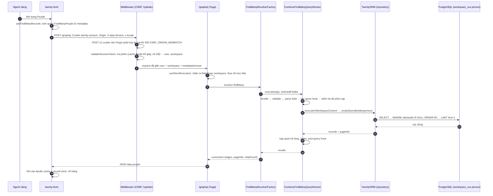
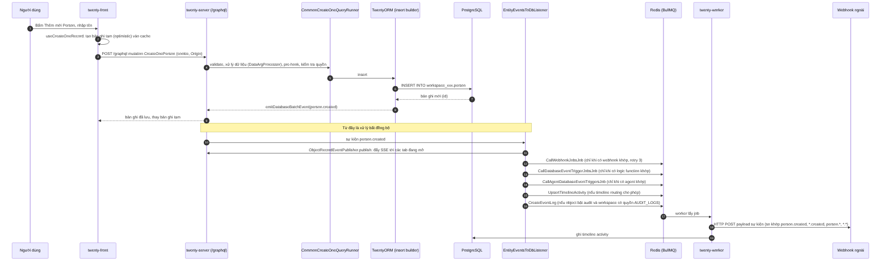
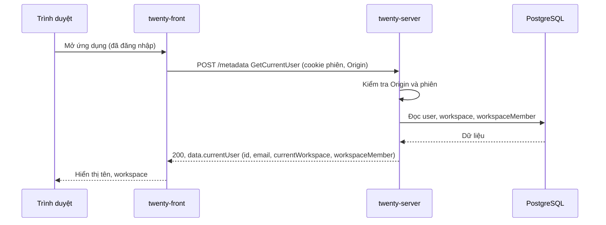
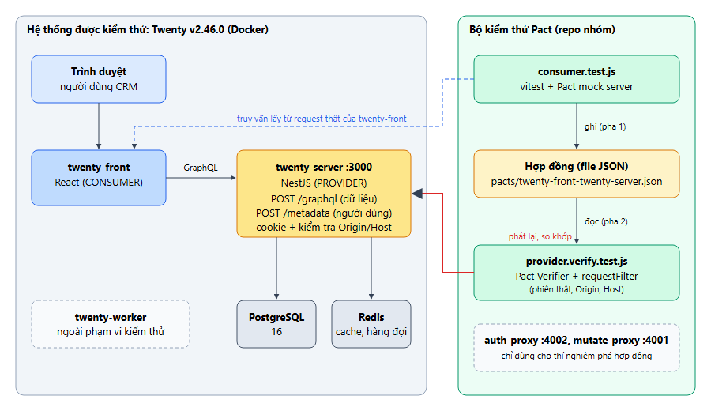

# BÁO CÁO CUỐI KỲ: CONTRACT TESTING (PACT) CHO TWENTY CRM

Môn Kiểm thử Phần mềm, ĐH Đà Lạt. GV: Nguyễn Thế Lâm. Nhóm 12. Đề tài R10 (Twenty CRM) × K04 (Contract Testing, Pact).
Thành viên: Phan Lê Xuân Mạnh (2312686), Liêng Hót Ha Luyến (2312682), Mai Quý Phước (2312716).
Repo: https://github.com/xuanmanhneee/twenty-pact-contract-testing · Tag nộp: ⏳ CHỜ (mục 6.3 TASKS)

> **Cách đọc bản nháp này.** Đây là khung báo cáo đã điền sẵn phần có số liệu thật. Quy ước đánh dấu:
> - `⏳ CHỜ [người / mục TASKS]`: chưa có kết quả hoặc chưa ai viết; không tự điền khi chưa có.
> - `📎 Nguồn:` file trong repo chứa dữ liệu gốc, dùng để đối chiếu hoặc chép số.
> - Phần A, B, D và kết quả chạy trên môi trường mới đã gộp ngày 28/11/2026; từ nay sửa trực tiếp trong file này.
> Trước khi nộp: xóa mọi dấu `⏳`, `📎`, hộp ghi chú này.

---

## 0. Tóm tắt
Nhóm áp dụng consumer-driven contract testing bằng Pact lên cặp `twenty-front` (consumer) và `twenty-server` (provider) của Twenty CRM v2.46.0. Hợp đồng gồm **7 interaction** (4 luồng đọc/ghi dữ liệu, 1 lấy người dùng hiện tại, 2 trường hợp lỗi), sinh từ request thật của twenty-front.
Kết quả ngày 21/11/2026: consumer **7/7**, Verifier gọi thẳng Twenty thật **7/7**. Năm thí nghiệm phá hợp đồng (đổi tên, xóa, đổi kiểu, thêm field, đối chứng) đều cho kết quả đúng kỳ vọng: chỉ các interaction dùng field bị đổi mới fail, không có báo động giả.
Trong quá trình làm, nhóm tìm ra và xử lý bốn vấn đề của harness (KI-1 đến KI-4); chưa phát hiện lỗi nào của chính Twenty. Phần G giải thích vì sao đây vẫn là kết quả có giá trị.
📎 Nguồn: `docs/report-context.md` mục 3, 4.

## 1. Phân công và đóng góp
⏳ CHỜ [cả nhóm, TASKS 7.1, 7.4]: dán bảng cuối cùng từ `docs/report/phan-cong-cong-viec.md` (đã có checklist việc đã xong; còn chờ tỷ lệ peer review).
Quản lý công việc (Trello/Jira/GitHub Projects): ⏳ CHỜ [Mạnh, TASKS 7.2].

---

# PHẦN I. PHÂN TÍCH HỆ THỐNG VÀ MÔI TRƯỜNG

## A. Mô tả hệ thống

### A.1 Mục tiêu hệ thống
Twenty là phần mềm CRM (quản lý quan hệ khách hàng) mã nguồn mở, được xem là phương án thay thế Salesforce.
Nó giúp một nhóm kinh doanh lưu và theo dõi:
- **People**: từng khách hàng, liên hệ.
- **Companies**: công ty mà các liên hệ thuộc về.
- **Opportunities**: cơ hội bán hàng (deal), gồm giá trị và ngày dự kiến chốt.

Ngoài ra còn ghi chú, tác vụ, quy trình tự động, và cho phép mỗi workspace tự thêm đối tượng và field riêng.
Nhóm kiểm thử phần giao tiếp giữa giao diện và máy chủ của hệ thống này (xem phần B, D).

### A.2 Actor và use case chính
| Actor | Use case |
|---|---|
| Người dùng workspace (nhân viên kinh doanh) | Đăng nhập; xem danh sách People, Companies, Opportunities; tạo bản ghi mới (ví dụ Person); xem thông tin tài khoản của mình |
| Quản trị workspace | Mời và quản lý thành viên; cấu hình đối tượng và field tùy biến |
| Hệ thống ngoài | Gọi API hoặc nhận webhook (ngoài phạm vi kiểm thử của nhóm) |

Các use case nằm trong phạm vi kiểm thử, kèm interaction tương ứng ([`docs/interactions.md`](../interactions.md)):

| Use case | Interaction |
|---|---|
| Xem danh sách People | I-01 |
| Xem danh sách Companies | I-02 |
| Tạo Person | I-03 |
| Xem danh sách Opportunities | I-04 |
| Lấy người dùng hiện tại | I-05 |
| Truy cập với phiên sai | I-06 |
| Truy cập thiếu Origin (chống CSRF) | I-07 |

### A.3 Cấu trúc thư mục và dependency

#### Monorepo Twenty (đối tượng được kiểm thử)
Twenty là monorepo Nx/Yarn gồm 19 gói trong `packages/`. Mức 2 của cây thư mục, rút gọn theo các gói liên quan:

```
twenty/                       (tag sdk/v2.46.0, commit 9070979)
└── packages/
    ├── twenty-front/         SPA React, gửi truy vấn GraphQL           ← CONSUMER
    ├── twenty-server/        NestJS, /graphql và /metadata, xác thực    ← PROVIDER
    │   └── src/
    │       ├── engine/       middleware (CSRF, cookie), api, core-modules, metadata-modules
    │       ├── modules/      nghiệp vụ CRM: person, company, opportunity, ...
    │       └── queue-worker/ điểm vào của worker (chạy nền)
    ├── twenty-shared/        kiểu và hằng số dùng chung
    ├── twenty-ui/            thư viện component giao diện
    ├── twenty-emails/        mẫu email
    ├── twenty-sdk, twenty-client-sdk/   SDK cho ứng dụng mở rộng
    ├── twenty-e2e-testing/   Playwright
    └── twenty-docker/        Dockerfile, docker-compose
```
Front và server **không phụ thuộc trực tiếp vào nhau**; chúng chỉ gặp nhau qua giao thức GraphQL và cookie phiên. Đó là ranh giới để đặt hợp đồng Pact.
Nhóm không chạy từ mã nguồn mà chạy image Docker đã pin; mã nguồn chỉ để đọc hiểu (xem [`VERSIONS.md`](../../VERSIONS.md)).
Nguồn số liệu: phân tích mã tag chính thức của nhóm ở giai đoạn 1. **Lưu ý:** cây trên là bản rút gọn từ phân tích đó, chưa chạy lại `tree -L 2` trên bản clone; nếu cần ảnh `tree` thật thì chạy trên bản clone của tag này.
⏳ CHỜ [Luyến, TASKS 2.2]: chạy `tree -L 2` thật rồi cập nhật cây và ghi chú trên.

#### Repo của nhóm (bộ kiểm thử Pact)
```
twenty-pact-contract-testing/
├── docker/        docker-compose.yml (Twenty, PostgreSQL, Redis đã pin digest), .env.example
├── tests/         consumer.test.js, provider.verify.test.js, queries.js,
│                  auth-proxy.mjs, mutate-proxy.mjs, experiments.mjs, run-all.mjs
├── pacts/         hợp đồng JSON được sinh ra
├── logs/          log chạy, ảnh bằng chứng, kết quả thí nghiệm
├── docs/          tài liệu, báo cáo
├── slides/        slide thuyết trình (Slidev)
├── package.json, VERSIONS.md, README.md, TASKS.md
```

#### Dependency chính
| Thành phần | Phiên bản | Dùng để | Nguồn |
|---|---|---|---|
| Twenty (server, worker) | `twentycrm/twenty:v2.46.0` (pin digest) | Hệ thống được kiểm thử | `VERSIONS.md`, `docker/docker-compose.yml` |
| PostgreSQL | 16 (pin digest) | Lưu dữ liệu workspace | `docker/docker-compose.yml` |
| Redis | pin digest | Cache, hàng đợi | `docker/docker-compose.yml` |
| Node.js | ≥ 22 | Chạy bộ test | `docs/setup.md` |
| `@pact-foundation/pact` | 16.5.0 (`^16.0.0`) | Consumer test, Pact Verifier | `package.json`, `package-lock.json` |
| `vitest` | 3.2.7 (`^3.0.0`) | Chạy test | `package.json`, `package-lock.json` |
| `cross-env`, `rimraf` | `^7.0.3`, `^6.0.0` | Tiện ích cho script npm | `package.json` |

Dependency bên trong Twenty (NestJS 11, GraphQL Yoga, TypeORM, BullMQ, React 19, Apollo Client 4, ...) do image đóng gói, nhóm không can thiệp.

### A.4 Luồng dữ liệu của các nghiệp vụ trọng tâm

#### Xem danh sách People (I-01)


Tóm tắt từng bước:
1. Người dùng mở trang People.
2. `twenty-front` dựng truy vấn `FindManyPeople` từ metadata của workspace và gửi `POST /graphql` kèm cookie phiên `twenty-session`, header `Origin` và `x-app-version`.
3. `twenty-server` kiểm tra Origin (chống CSRF) và phiên; nếu hợp lệ thì chạy truy vấn trên PostgreSQL.
4. Server trả `data.people` gồm `edges[].node` (`id`, `name`, `emails`, `jobTitle`), `pageInfo` và `totalCount`.

Xem Companies (I-02) và Opportunities (I-04) đi theo đúng luồng này, chỉ khác tên truy vấn (`FindManyCompanies`, `FindManyOpportunities`).

#### Tạo Person (I-03)


Tóm tắt từng bước:
1. Người dùng bấm thêm mới Person; front gửi mutation `CreateOnePerson` tới `/graphql`.
2. Server kiểm tra phiên và Origin, ghi bản ghi vào PostgreSQL.
3. Server trả bản ghi mới (có `id`, `name`, `emails`, `jobTitle`, `position`, `createdAt`, `createdBy`).
4. Sau khi ghi, server còn phát sự kiện bất đồng bộ qua Redis cho worker (webhook, timeline); phần này ngoài phạm vi kiểm thử.

Vì I-03 ghi dữ liệu thật nên provider state phải dọn fixture trước và sau mỗi lượt verify ([`docs/interactions.md`](../interactions.md)).

#### Lấy người dùng hiện tại (I-05)

Khác với hai luồng trên, luồng này đi qua endpoint `/metadata` thay vì `/graphql`.

#### Phiên sai và thiếu Origin (I-06, I-07)
| Tình huống | Hành vi thật của Twenty v2.46.0 | Interaction |
|---|---|---|
| Cookie phiên sai | HTTP **200** kèm `errors[]` (không phải 401) | I-06 |
| Có cookie nhưng không có Origin hợp lệ | HTTP **403**, `error: CSRF_ORIGIN_MISMATCH` | I-07 |

Nguồn: [`docs/architecture.md`](../architecture.md), [`docs/interactions.md`](../interactions.md), [`docs/archive/bao_cao_giua_ky_milestone_2.md`](../archive/bao_cao_giua_ky_milestone_2.md) mục A, phân tích mã nguồn giai đoạn 1 (sơ đồ luồng lấy từ đó).

## B. Kiến trúc hệ thống

### B.1 Sơ đồ kiến trúc và vị trí của Pact



(Bản vector: [`img/kien-truc.svg`](img/kien-truc.svg).)

Cách đọc sơ đồ:
- **Khung trái** là hệ thống được kiểm thử, chạy bằng Docker từ image Twenty `v2.46.0` đã pin theo digest (xem [`VERSIONS.md`](../../VERSIONS.md)).
  Người dùng thao tác trên trình duyệt; `twenty-front` gửi truy vấn GraphQL tới `twenty-server`, server đọc/ghi PostgreSQL và dùng Redis làm cache, hàng đợi.
- **Khung phải** là bộ kiểm thử của nhóm. Pha 1 (consumer): `consumer.test.js` chạy với Pact mock server và ghi ra file hợp đồng JSON.
  Pha 2 (provider): `provider.verify.test.js` đọc hợp đồng, phát lại từng request lên `twenty-server` thật ở `:3000` và so khớp response.
- Đường nét đứt xanh: truy vấn trong hợp đồng được lấy từ request thật của `twenty-front` (DevTools), không tự viết.
- `auth-proxy` và `mutate-proxy` không nằm trên đường verify chính; chỉ dùng cho thí nghiệm phá hợp đồng ([`docs/testing.md`](../testing.md)).

### B.2 Các module liên quan trực tiếp tới kiểm thử

| Module | Giải thích | Vì sao liên quan |
|---|---|---|
| `twenty-front` (React) | Giao diện; sinh truy vấn GraphQL như `FindManyPeople`, `CreateOnePerson`, `GetCurrentUser` | Là **consumer**: truy vấn của nó xác định field nào thật sự được dùng, tức nội dung hợp đồng |
| `twenty-server` — `POST /graphql` | Điểm vào cho dữ liệu bản ghi (People, Companies, Opportunities, mutation) | Là **provider** của 6 trong 7 interaction (I-01 đến I-04, I-06, I-07) |
| `twenty-server` — `POST /metadata` | Metadata và người dùng hiện tại | Là provider của I-05; schema được sinh động theo workspace nên dễ phát sinh breaking change |
| Xác thực cookie và chống CSRF | Phiên nằm trong cookie `twenty-session=sess_...`; request dùng cookie mà thiếu Origin hợp lệ bị `403 CSRF_ORIGIN_MISMATCH`; Twenty đối chiếu Origin với Host (bài học KI-4) | Quyết định HTTP 200 hay 403; I-06 (phiên sai, HTTP 200 kèm `errors[]`) và I-07 (thiếu Origin, 403) kiểm đúng hành vi này |
| PostgreSQL 16 và dữ liệu mẫu | Lưu dữ liệu workspace; tối thiểu 1 Person, 1 Company, 1 Opportunity ([`docs/setup.md`](../setup.md) mục 2) | Là nền cho **provider state**: precondition của mỗi interaction thật sự phụ thuộc dữ liệu này |
| Pact (consumer test, Verifier, provider state) | `@pact-foundation/pact` 16.x chạy trong vitest; provider state handler kiểm precondition và dọn fixture I-03 | Là công cụ tạo và kiểm chứng hợp đồng |

### B.3 Điểm cần lưu ý về kiến trúc khi viết hợp đồng
- Lỗi GraphQL trả **HTTP 200** kèm `errors[]`, nên chỉ kiểm status code là không đủ (I-06).
- Verifier phát lại request với `Host` khác, nên `requestFilter` phải đặt lại `Host` và `Origin`, nếu không 5 interaction dùng phiên hợp lệ bị 403 (KI-4, [`docs/known-issues.md`](../known-issues.md)).
- Đối tượng kiểm thử là **image Docker đã pin**, không phải mã nguồn; kết quả không phụ thuộc source đối chiếu.

Nguồn: [`docs/architecture.md`](../architecture.md), [`docs/interactions.md`](../interactions.md), [`docs/known-issues.md`](../known-issues.md).

## C. Môi trường và bằng chứng chạy thành công
### C.1 Môi trường thực tế
| Thành phần | Phiên bản |
|---|---|
| Twenty server/worker | `twentycrm/twenty:v2.46.0` (pin digest `sha256:bb4e94f0...`, build 09/10/2026) |
| PostgreSQL | `postgres:16` (pin digest) |
| Redis | pin digest |
| Node.js | ≥ 22 (đã chạy với v26.13.0 trên Windows 11) |
| Pact | `@pact-foundation/pact` 16.5.0 |
| Test runner | vitest 3.x |
📎 Nguồn: `VERSIONS.md` (digest đầy đủ). Source tham chiếu: tag `sdk/v2.46.0` (commit `9070979`, 09/10/2026, trùng ngày build image); image không công bố commit nên chưa chứng minh khớp từng byte, kết quả không phụ thuộc source.

### C.2 Hướng dẫn dựng hệ thống
1. `cd docker && cp .env.example .env`, điền các giá trị `CHANGE_ME` (mật khẩu PostgreSQL, khóa mã hóa sinh bằng `openssl rand -base64 32`); `docker compose up -d`; kiểm tra `curl http://localhost:3000/healthz`.
2. Mở http://localhost:3000, tạo tài khoản và workspace (đề nghị tên `dlu-qa`, không bắt buộc). Dữ liệu tối thiểu: 1 Person, 1 Company, 1 Opportunity.
3. Lấy phiên: đăng nhập, F12 → Network → request `graphql` → cookie `twenty-session=sess_...`; dán giá trị vào `token.txt`.
4. Gỡ proxy hệ thống (`unset HTTP_PROXY HTTPS_PROXY`), `npm install`, chạy `npm run test:consumer`, `npm run test:provider`.
📎 Nguồn: `README.md`, `docs/setup.md`.
Bảng xử lý lỗi thường gặp (Docker chưa chạy, phiên hết hạn, 403 CSRF, thiếu dữ liệu, cổng bận): `docs/setup.md` mục 7.

**Kết quả chạy lại trên môi trường mới (24/11/2026).** Clone mới, `npm install` mới, `docker/.env` mới, project Docker mới (volume và DB mới), tài khoản và workspace mới. Máy: i5-12450H, 16 GB RAM, Windows 11, Docker 29.7.2, Node v22.18.0.

| Bước | Kết quả | Thời gian |
|---|---|---|
| Chờ Twenty khởi động đến khi `/healthz` trả `ok` | Đạt | khoảng 4 phút |
| `npm run test:consumer` | 7/7 | 6,10 s (vitest) |
| `npm run test:provider` | 7/7 | 6,77 s (vitest) |

Tổng từ lúc clone đến khi đạt 7/7: khoảng 7 đến 8 phút. Giới hạn: lượt này do công cụ AI (Claude Code) chạy trên máy của Luyến theo yêu cầu; tài khoản, workspace và phiên được tạo qua API thay vì giao diện và DevTools như tài liệu; image Docker đã có trong cache; chỉ chạy một lần.
📎 Nguồn: [`clean-run.md`](clean-run.md), `logs/clean-run/sach-consumer.log`, `sach-provider.log`.

### C.3 Bằng chứng hệ thống chạy được
| Luồng | Bằng chứng | Trạng thái |
|---|---|---|
| Xem People | `logs/people.png`; contract I-01 pass | Có |
| Xem Companies | `logs/f3-companies.png`; contract I-02 pass | Có |
| Người dùng hiện tại | `logs/f4-current-user.png`; contract I-05 pass | Có |
| Xem Opportunities | `logs/opportunities.png`; contract I-04 pass | Có |
| Tạo Person | `logs/probe-i03-people.png`, `logs/probe-i03-mutation.json`; contract I-03 pass | Có |
⏳ CHỜ [Phước, TASKS 4.2]: rà ảnh không lộ cookie; ảnh `/healthz` và màn hình đăng nhập nếu cần.

---

# PHẦN II. ÁP DỤNG CONTRACT TESTING

## D. Cơ sở lý thuyết, phạm vi, giả định, rủi ro, tiêu chí

### D.1 Nguyên lý Contract Testing
**Hợp đồng (contract)** là bản ghi chính xác về cách hai thành phần nói chuyện với nhau: request nào được gửi, response nào được mong đợi.
Với **consumer-driven contract testing** (Pact), bên dùng dịch vụ (consumer) là bên đặt ra hợp đồng. Quy trình có hai pha:

1. **Pha consumer.** Test của consumer chạy với một *mock provider* do Pact dựng. Mỗi lần test gửi request và nhận response giả, Pact ghi cặp request/response đó vào file hợp đồng JSON.
2. **Pha provider.** *Pact Verifier* đọc file hợp đồng, phát lại từng request lên provider thật và so khớp response. Trước mỗi interaction, **provider state** đưa provider về đúng trạng thái dữ liệu mà interaction cần (ví dụ "workspace có ít nhất 1 Person").

Điểm khác với các kiểu test khác:
| Kiểu test | Cách làm | Khác với contract test |
|---|---|---|
| Integration test | Chạy cả hai bên cùng lúc và kiểm hành vi tổng | Chậm, nặng; khi fail khó biết bên nào sai |
| End-to-end (E2E) | Thao tác trên giao diện thật, đi qua mọi tầng | Chậm, dễ chập chờn; không chỉ rõ chỗ vỡ |
| Contract test | Kiểm riêng điểm nối giữa consumer và provider qua hợp đồng | Phạm vi hẹp nên nhanh, không cần giao diện thật; pha consumer không cần server, pha provider vẫn cần provider chạy thật (ở đây: Twenty, PostgreSQL, Redis); fail chỉ rõ interaction bị vi phạm |

Hợp đồng chỉ chứa phần consumer **thực sự dùng**, nên provider vẫn tự do đổi phần không ai dùng mà không báo động giả.

### D.2 Vì sao phù hợp với Twenty
- `twenty-front` và `twenty-server` tách rời hoàn toàn (không phụ thuộc trực tiếp vào nhau), chỉ giao tiếp qua GraphQL và cookie phiên. Đó chính là điểm nối mà Pact kiểm tra.
- Rủi ro thật: server đổi tên hoặc bỏ một field thì front hỏng mà không test nào báo trước. Theo đặc tả GraphQL, truy vấn field không có trong schema bị lỗi validate (`Cannot query field ...`), nên cả truy vấn cũ của front sẽ hỏng. Lỗi này có thể đi kèm HTTP 200 và `errors[]` (đã quan sát ở I-06), nên chỉ kiểm status code sẽ không phát hiện.
- Hai nhóm làm việc độc lập (giao diện, máy chủ) rất cần một "hợp đồng" rõ ràng để thay đổi một bên mà biết ngay có ảnh hưởng bên kia hay không.
- Truy vấn của front được sinh từ metadata của workspace nên dễ lệch; hợp đồng chốt lại hình dạng dữ liệu mà front thật sự cần.

### D.3 Phạm vi
**Trong phạm vi** (7 interaction, [`docs/interactions.md`](../interactions.md)):
- `POST /graphql`: đọc People, Companies, Opportunities (I-01, I-02, I-04); tạo Person (I-03).
- `POST /metadata`: người dùng hiện tại (I-05).
- Hành vi xác thực và chống CSRF: phiên sai (I-06), thiếu Origin (I-07).

**Ngoài phạm vi:** `/metadata` ở mức đầy đủ, REST `/rest/...`, worker và hàng đợi, email, tích hợp bên thứ ba, hiệu năng, giao diện.
Lý do chọn: đây là các luồng front–server rõ ràng nhất, có truy vấn thật bắt được từ DevTools, đủ phủ đọc, ghi, metadata và xác thực với số lượng vừa sức (yêu cầu của đề tài là từ 5 interaction).
Hợp đồng chỉ kiểm **hình dạng** dữ liệu (tên field, kiểu, status code), không kiểm nghiệp vụ hay hiệu năng.

### D.4 Giả định
1. Image Twenty `v2.46.0` (pin theo digest) giữ nguyên suốt dự án.
2. Dữ liệu workspace ổn định, tối thiểu 1 Person, 1 Company, 1 Opportunity, đóng vai trò provider state. Tên workspace (`dlu-qa`) chỉ là quy ước, không ảnh hưởng kết quả vì hợp đồng dùng matcher kiểu chuỗi.
3. Verifier lấy được phiên đăng nhập hợp lệ (lấy thủ công, đặt vào `token.txt`).
4. Source đối chiếu (tag `sdk/v2.46.0`, commit `9070979`) chỉ để đọc hiểu; kết quả không phụ thuộc source vì hợp đồng verify trực tiếp vào image.

### D.5 Rủi ro và cách xử lý
Gồm cả rủi ro đã **thực sự gặp** trong dự án:

| Rủi ro | Trạng thái | Xử lý |
|---|---|---|
| **KI-1:** I-07 fail khi verify qua proxy vì proxy luôn đặt Origin, nên server trả 200 thay vì 403 | Đã gặp, đã sửa (21/11) | Chỉ đặt Origin khi request gốc có Origin |
| **KI-4:** Verifier gọi thẳng Twenty bị 403 `CSRF_ORIGIN_MISMATCH` ở 5 interaction dùng phiên hợp lệ. Nguyên nhân gốc: Verifier gửi `Host: 127.0.0.1:<cổng ngẫu nhiên>`, Twenty đối chiếu Origin với Host | Đã gặp, đã sửa (21/11) | `requestFilter` đặt lại Host về host của Origin; verify gọi thẳng 7/7 |
| **KI-2, KI-3:** thiếu provider state handler; I-03 để lại dữ liệu | Đã gặp, đã sửa (21/11) | Đủ 7 handler kiểm precondition thật; fixture I-03 được dọn trước và sau mỗi lượt |
| Schema động theo workspace | Còn | Dùng workspace cố định với dữ liệu tối thiểu |
| Phiên có thời hạn (đã thấy dùng được qua đêm, chưa đo hạn thật) | Còn | Lấy phiên mới khi verify báo `UNAUTHENTICATED` |
| Lỗi GraphQL trả HTTP 200 nên dễ bỏ sót | Đã xử lý | Đưa `errors[]` vào hợp đồng (I-06) |
| Thí nghiệm phá hợp đồng mới mô phỏng ở lớp proxy, chưa sửa mã Twenty thật | Còn (giới hạn) | Ghi rõ trong báo cáo; xem [`docs/known-issues.md`](../known-issues.md) |

Chi tiết nguyên nhân và cách sửa từng lỗi: [`docs/known-issues.md`](../known-issues.md).

### D.6 Tiêu chí pass/fail
Đối chiếu ngưỡng đặt ra ([`docs/contract-testing.md`](../contract-testing.md)) với kết quả thật ([`docs/testing.md`](../testing.md), `logs/`):

| Tiêu chí | Ngưỡng đạt | Kết quả thực tế |
|---|---|---|
| Số interaction | ≥ 5 | 7 |
| Verify trên server nguyên bản | 100% interaction pass | 7/7 (gọi thẳng `:3000`, 21/11/2026) |
| Phát hiện breaking change | Mỗi loại thay đổi (đổi tên, xóa field, đổi kiểu) làm ít nhất 1 interaction liên quan fail | M-2 đổi tên: I-01, I-03 fail; M-3 xóa field: I-04 fail; M-4 đổi kiểu: I-01, I-02, I-04 fail |
| Ca âm xác thực | Response thật khớp hành vi từ chối đã ghi trong hợp đồng | I-06 (phiên sai: 200 kèm `errors[]`) và I-07 (thiếu Origin: 403) đều pass |
| Báo động giả | 0 | 0: M-0 (đối chứng) và M-6 (chỉ thêm field) đều 7/7 OK |
| Tái chạy | Người khác chạy lại theo README trên máy mới ra cùng kết quả | Đạt trên môi trường mới (clone, volume Docker, tài khoản mới, 24/11/2026): consumer 7/7, provider 7/7. Hạn chế: lượt này do công cụ AI chạy trên máy của Luyến, tạo tài khoản bằng API, chạy một lần ([`clean-run.md`](clean-run.md)) |

Một interaction được coi là **pass** khi response thật khớp hợp đồng về status code, header liên quan và hình dạng body (kiểu từng field qua matcher); **fail** khi thiếu field, sai kiểu hoặc sai status.
Kết luận chung cho bộ hợp đồng: đạt khi toàn bộ interaction pass trên server nguyên bản và mọi breaking change được mô phỏng đều làm fail đúng interaction liên quan.

### Giới hạn của kỹ thuật
- Chỉ kiểm hình dạng dữ liệu, không kiểm nghiệp vụ hay hiệu năng.
- Không thay thế E2E; chỉ phủ điểm nối consumer–provider.
- Thí nghiệm chỉ sửa response ở lớp proxy. Nếu server thật đổi tên hoặc xóa field trong schema, truy vấn cũ sẽ bị lỗi validate, nên log lỗi sẽ khác log của thí nghiệm.
- Kết quả thí nghiệm là mô phỏng, mỗi lượt chạy một lần (chưa đo độ ổn định qua nhiều lần chạy).

## E. Thiết kế test scenario và test case
Chi tiết (viết bởi Phước): ⏳ CHỜ [Phước, TASKS 5.2, 5.3] → `docs/report/E-scenario.md` (kỹ thuật thiết kế: ca dương, ca âm, thử phá hợp đồng; vì sao query lấy từ request thật).

### E.1 Danh sách interaction
Request chung (trừ I-07): `Content-Type: application/json`, cookie `twenty-session=valid-session` (Verifier thay bằng phiên thật), `Origin: http://localhost:3000`, `x-app-version: v2.46.0`.

| ID | Provider state | Endpoint | Operation | Precondition | Expected |
|---|---|---|---|---|---|
| I-01 | workspace có ít nhất 1 Person | `/graphql` | FindManyPeople | ≥ 1 Person; phiên hợp lệ | 200; `data.people.edges[].node` có `id`, `name`, `emails`, `jobTitle`; có `pageInfo`, `totalCount` |
| I-02 | workspace có ít nhất 1 Company | `/graphql` | FindManyCompanies | ≥ 1 Company | 200; node có `id`, `name`, `domainName.primaryLinkUrl` |
| I-03 | workspace sẵn sàng tạo Person I-03 | `/graphql` | CreateOnePerson (mutation) | fixture UUID `d05b3c0b-...` chưa tồn tại | 200; `data.createPerson` có `id` đúng fixture, `name`, `emails`, `jobTitle`, `position`, `createdAt`, `createdBy` |
| I-04 | workspace có ít nhất 1 Opportunity | `/graphql` | FindManyOpportunities | ≥ 1 Opportunity | 200; node có `id`, `name`, `amount`, `closeDate`, `company` |
| I-05 | người dùng đã đăng nhập vào workspace | `/metadata` | GetCurrentUser | đã đăng nhập | 200; `data.currentUser` có `id`, `email`, `onboardingStatus`, `currentWorkspace`, `workspaceMember` |
| I-06 | phiên không hợp lệ | `/graphql` | FindManyPeople | cookie `session-sai` | 200 (Twenty không đổi status); `errors[].message` lỗi validate schema |
| I-07 | phiên hợp lệ nhưng request thiếu Origin | `/graphql` | FindManyPeople | không gửi Origin | 403; body `{statusCode:403, messages:["Request origin is not allowed for cookie-authenticated requests"], error:"CSRF_ORIGIN_MISMATCH"}` |
📎 Nguồn: `docs/interactions.md`, `tests/queries.js`, `tests/consumer.test.js`.

### E.2 Dữ liệu test và provider state
Dữ liệu: workspace có ≥ 1 Person, 1 Company, 1 Opportunity (workspace của nhóm: 5/5/6). Fixture duy nhất tạo mới là Person của I-03, được `setup`/`teardown` xóa vĩnh viễn (xóa mềm rồi `destroyPerson`) trước và sau mỗi lượt, nên chạy lặp không để rác.

### E.3 Kịch bản phá hợp đồng (negative control)
| Mã | Thay đổi mô phỏng | Phía | Interaction phải fail |
|---|---|---|---|
| M-0 | Đối chứng: proxy chuyển tiếp nguyên vẹn | Provider | (không) |
| M-1 | Hợp đồng đổi `jobTitle` → `jobTitleName` | Consumer | I-01 |
| M-2 | Provider đổi tên `jobTitle` → `jobTitleName` | Provider | I-01, I-03 |
| M-3 | Provider xóa field `amount` | Provider | I-04 |
| M-4 | Provider đổi kiểu `totalCount` số → chuỗi | Provider | I-01, I-02, I-04 |
| M-6 | Provider thêm field `jobTitleExtra` | Provider | (không: tương thích ngược) |
Lưu ý: M-0, M-2, M-3, M-4, M-6 được mô phỏng bằng `mutate-proxy` ở lớp mạng, server Twenty thật không bị sửa. M-1 sửa ở phía consumer và mới chạy trên bộ 6 interaction cũ.
⏳ CHỜ [Phước, TASKS 1.3]: chạy M-1 trên bộ 7 interaction rồi cập nhật cột "Interaction phải fail" theo log.
📎 Nguồn: `docs/testing.md`.

## F. Mã nguồn test và cách chạy lại
| Thành phần | File |
|---|---|
| Truy vấn và biến | `tests/queries.js` |
| Consumer test (sinh hợp đồng) | `tests/consumer.test.js` |
| Hợp đồng sinh ra | `pacts/twenty-front-twenty-server.json` |
| Provider verify, state handler, requestFilter | `tests/provider.verify.test.js` |
| Proxy thí nghiệm | `tests/mutate-proxy.mjs`, `tests/auth-proxy.mjs` (chỉ cho thí nghiệm) |
| Chạy thí nghiệm | `tests/experiments.mjs` |

| Lệnh | Tác dụng |
|---|---|
| `npm run test:consumer` | Sinh hợp đồng từ consumer test |
| `npm run test:provider` | Verifier gọi thẳng Twenty `:3000`, kỳ vọng 7/7 |
| `npm run experiments` | Chạy M-0, M-2, M-3, M-4, M-6, ghi `logs/experiments/` |
| `npm run all` | Một lệnh chạy toàn bộ (kiểm tra điều kiện, consumer, provider, thí nghiệm), in tóm tắt, ghi `logs/run-all-summary.md`; lượt chạy 21/11/2026: tất cả đạt |
Trên môi trường mới (mục C.2), `test:consumer` và `test:provider` đều đạt 7/7.
⏳ CHỜ [Luyến, TASKS 4.3]: chạy `npm run all` trên môi trường mới (lượt 24/11 chưa ghi nhận lệnh này).

## G. Log, metrics và phân tích
### G.1 Kết quả chạy (21/11/2026, Windows 11, Node v26.13.0, Pact 16.5.0, Twenty v2.46.0)
| Lượt chạy | Interaction | Pass | Fail | Thời gian vitest |
|---|---|---|---|---|
| Consumer | 7 | 7 | 0 | 1,25 s |
| Provider gọi thẳng `:3000` | 7 | 7 | 0 | 3,16 s |
| Thí nghiệm M-0 | 7 | 7 | 0 | 5,48 s |
| M-2 / M-3 / M-4 / M-6 | 7 | 5 / 6 / 4 / 7 | 2 / 1 / 3 / 0 | 2,96 / 3,10 / 3,05 / 3,00 s |

Thời gian verify từng interaction: I-01 302 ms, I-02 84 ms, I-03 1,10 s (gồm setup và teardown), I-04 81 ms, I-05 103 ms, I-06 18 ms, I-07 16 ms.
📎 Nguồn: `docs/testing.md`, `logs/consumer-run-21-11.log`, `logs/provider-run-direct-21-11.log`, `logs/experiments-run-21-11.log`, `logs/experiments/summary.md`.
⏳ CHỜ [Phước, TASKS 1.3]: `BREAK=1` trên bộ 7 interaction (kỳ vọng fail I-01 và I-03).

### G.2 Ý nghĩa các dòng log của Verifier
⏳ CHỜ [Phước, TASKS 6.2]: giải thích `OK`, `FAILED`, `Actual map is missing the following keys: <field>` (field biến mất), `Expected '5' (String) to be an integer` (đổi kiểu), `expected 200 but was 403` (sai status). Ví dụ thật nằm trong `logs/experiments/M-2.log`, `M-3.log`, `M-4.log`.

### G.3 Hành vi bất thường và nguyên nhân gốc
| Mã | Hiện tượng | Nguyên nhân gốc | Xử lý |
|---|---|---|---|
| KI-1 | I-07 nhận 200, kỳ vọng 403 | Proxy và `requestFilter` đặt Origin cho mọi request | Chỉ đặt Origin khi request gốc có Origin |
| KI-2 | Verifier cảnh báo thiếu state | Chưa có handler cho 5 state | Đủ 7 handler |
| KI-3 | I-03 tạo Person thật, chạy lặp trùng UUID | Không có teardown | `setup`/`teardown` tự xóa |
| KI-4 | Gọi thẳng Twenty, 5 interaction bị 403 | Verifier gửi `Host: 127.0.0.1:<cổng ngẫu nhiên>`, Twenty đối chiếu Origin với Host | `requestFilter` đặt lại Host |

Quan sát về hành vi của Twenty v2.46.0 (không phải lỗi): phiên sai trả HTTP 200 thay vì 401; 403 CSRF không có `extensions.code`; `GetCurrentUser` đi qua `/metadata`.

### G.4 Có phát hiện lỗi của Twenty không?
Chưa. Bốn vấn đề trên là của môi trường và harness của nhóm. Một sản phẩm mã nguồn mở đã bảo trì lâu, ở phạm vi hình dạng dữ liệu của 7 interaction, khó có lỗi nhìn thấy ngay. Thay vì tìm lỗi, nhóm chứng minh hai điều: (1) provider hiện tại thỏa hợp đồng (7/7); (2) hợp đồng **có khả năng phát hiện lỗi** khi provider thay đổi (M-2, M-3, M-4 fail đúng chỗ) và **không báo động giả** (M-0, M-6). Đây là bằng chứng chất lượng cho bộ test.
Giới hạn: thay đổi mô phỏng ở lớp proxy, mỗi lượt chạy một lần; chưa sửa mã nguồn Twenty thật.

## H. Pin phiên bản và tái lập
- Phiên bản đã pin: `VERSIONS.md`; hợp đồng được commit trong `pacts/`; `package-lock.json` khóa phụ thuộc test.
- ⏳ CHỜ [Mạnh, TASKS 6.3]: tag/commit SHA của bản nộp.
- Chạy lại trên môi trường mới ngày 24/11/2026: consumer 7/7, provider 7/7; các bước và giới hạn ở mục C.2 và [`clean-run.md`](clean-run.md).
⏳ CHỜ [cả nhóm]: thống nhất nhánh nộp, vì `origin/main` đã viết lại lịch sử; commit `752d346` dùng cho lượt chạy này không còn trên `main`.
- Cách người khác chạy lại: README và `docs/setup.md`. Điều kiện bắt buộc: Docker chạy Twenty, phiên `twenty-session` lấy thủ công (có thời hạn, đã thấy dùng được qua đêm), gỡ biến proxy hệ thống.

## 2. Hạn chế
- Mô phỏng thay đổi ở lớp proxy, chưa sửa mã server thật; chưa đo độ ổn định (lặp nhiều lần).
- Image đã pin; source đối chiếu (tag `sdk/v2.46.0`) trùng ngày build nhưng chưa chứng minh khớp từng byte.
- Phiên đăng nhập lấy thủ công, có thời hạn (đã thấy dùng được qua đêm, chưa đo hạn thật); chưa tự động hóa đăng nhập.
- Lượt chạy trên môi trường mới do công cụ AI thực hiện, tạo tài khoản bằng API, chạy một lần.
- Không có Pact Broker và CI; hợp đồng lưu trong repo.
- Chỉ kiểm hình dạng dữ liệu của 7 interaction, không kiểm nghiệp vụ, hiệu năng hay bảo mật.

## 3. Kết luận
Contract testing bằng Pact kiểm được sự tương thích giữa twenty-front và twenty-server nhanh (vài giây), cô lập, và chạy tự động. Bộ 7 interaction pass trên Twenty thật và phát hiện đúng các thay đổi phá vỡ mô phỏng. Bài học thực tế lớn nhất là các lỗi nằm ở tương tác với cơ chế bảo mật của hệ thống (CSRF qua Origin và Host), không phải ở hình dạng dữ liệu.
⏳ CHỜ: hoàn thiện sau khi có kết quả cuối (mục 1.3, `npm run all` trên môi trường mới) và ý kiến của nhóm.
